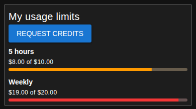

<a href="../../fr/user/usage.md">Français</a> · <strong>English</strong>

# Check usage and request credits

Open **Monitor → Usage → My usage limits** to see how much your account can use before its next reset. You can also select a gauge in the menu to open this page. Each gauge’s tooltip shows the amount used, the limit and the reset time.

| Period | When the allowance becomes available again |
|---|---|
| 5 hours | Five hours after the first admitted call. The next call starts a new window. |
| Weekly | Every week, on Monday at 00:00 UTC by default. Check the gauge for your account’s reset time. |
| Monthly | On the first day of the next calendar month at 00:00 UTC. |

All three limits apply together. For example, if you still have credit for the month but have reached your weekly limit, select the weekly period when you request credit.

## Request credit for your account

In this example, the account has $1 left for the week and $2 left in the five-hour period. Select **Request credits** to choose which allowance to increase.

1. Under **My usage limits**, find the affected period and check when it resets.
2. Select **Request credits**, choose the period, enter the extra amount you need under **Amount ($)** and select **Confirm**.
3. Open **Credit requests** to see the decision. **Pending** means a team lead still needs to review the request. An **Approved** request increases the available amount until the selected period resets.

You can have one pending request per period. If the page says no active team lead can review it, ask whoever manages your teams to check your [team membership and assigned lead](teams.md). If a call is still blocked after approval, check your other two limits.

## Review a team member’s request

1. Under **Monitor → Usage**, find the member’s row. Each column represents one period. A blank cell means usage is unlimited for that period.
2. Open **Credit requests** on that row. Check the amount and period, then select **Grant** or **Reject**. For the five-hour period, you can grant credit once the window has started.
3. After granting credit, check the gauge for that period on the member’s row. For example, granting $2 on a $5 monthly limit raises it to $7 until the next month.

To grant extra credit without a request, select **Add credit** on the member’s row. To change the amount that will also apply in future periods, select **Change limits**. In that form, leaving a limit blank allows unlimited usage for the period and entering zero suspends new calls. [Management permissions and usage accounting](../dev/inference-budgets.md)
