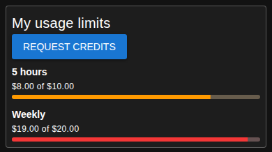

<strong>Français</strong> · <a href="../../en/user/usage.md">English</a>

# Consulter sa consommation et demander des crédits

Dans **Superviser → Consommation**, ouvrez **Mes limites d’utilisation** pour voir combien votre compte peut encore utiliser avant le prochain renouvellement. Vous pouvez aussi ouvrir cette page en sélectionnant une jauge du menu. Chaque jauge indique le montant consommé, le plafond et la date du renouvellement dans son infobulle.

| Période | Quand le montant redevient disponible |
|---|---|
| 5 heures | Cinq heures après le premier appel admis. Le prochain appel ouvre une nouvelle fenêtre. |
| Hebdomadaire | Toutes les semaines, le lundi à 00 h UTC par défaut. Consultez la jauge pour connaître l’horaire de votre compte. |
| Mensuelle | Le premier jour du mois civil suivant à 00 h UTC. |

Les trois plafonds s’appliquent ensemble. Par exemple, s’il reste du crédit pour le mois mais que le plafond hebdomadaire est atteint, c’est la semaine qu’il faut sélectionner pour demander du crédit.

## Demander un crédit pour son compte

Dans cet exemple, il reste 1 $ pour la semaine et 2 $ pour la période de cinq heures. Le bouton **Request credits** correspond à **Demander des crédits** dans l’interface française.

1. Dans **Mes limites d’utilisation**, repérez la période concernée et son prochain renouvellement.
2. Choisissez **Demander des crédits**, sélectionnez la période, saisissez le supplément souhaité dans **Montant ($)** et cliquez sur **Valider**.
3. Ouvrez **Demandes de crédits** pour suivre la réponse. **En attente** signifie qu’un chef d’équipe doit encore se prononcer. Une demande **Accordée** augmente le montant disponible jusqu’au renouvellement de la période choisie.

Vous pouvez avoir une demande en attente par période. Si la page signale qu’aucun chef d’équipe actif ne peut la traiter, demandez à la personne qui gère les équipes de vérifier votre [appartenance et la désignation du chef d’équipe](teams.md). Si un appel reste bloqué après un accord, vérifiez les deux autres plafonds.

## Traiter la demande d’un membre de son équipe

1. Dans **Superviser → Consommation**, repérez la ligne du membre. Chaque colonne correspond à une période. Une cellule vide indique un usage illimité.
2. Sur cette ligne, ouvrez **Demandes de crédits**. Vérifiez le montant et la période, puis choisissez **Accorder** ou **Refuser**. Pour la période de cinq heures, l’octroi devient possible une fois la fenêtre ouverte.
3. Après un accord, vérifiez la jauge de la période sur la ligne du membre. Par exemple, un crédit de 2 $ sur un plafond mensuel de 5 $ porte le plafond à 7 $ jusqu’au prochain mois.

Pour accorder un supplément sans demande préalable, utilisez **Ajouter du crédit** sur la ligne du membre. Pour modifier le montant qui s’appliquera aussi aux périodes suivantes, utilisez **Modifier les plafonds**. Dans ce formulaire, laisser une valeur vide rend l’usage illimité pour la période et saisir zéro suspend les nouveaux appels. [Droits de gestion et calcul de la consommation](../dev/inference-budgets.md)
