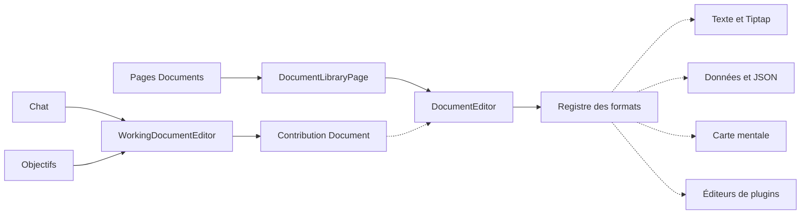

# Cartographie des composants Vue de Galaris

**19 novembre 2026, 06 h 56 (Europe/Paris)** · Arbre de travail basé sur `8b8c1d99`, avec les fichiers locaux en cours de modification.

Le frontend web est déjà organisé par domaine. Sur **462 liens d’import directs entre fichiers Vue**, **461** restent dans le même groupe. Les difficultés de maintenance se concentrent dans les façades partagées, trois boucles d’import et quelques écrans qui cumulent plusieurs responsabilités. Le découpage par domaine fournit une bonne base pour traiter ces points un par un.

[Catalogue des 524 fichiers Vue, avec routes, imports, références et tests repérés](2026-11-19-vue-components-catalogue.md)

Les chiffres et les constats ci-dessous décrivent le relevé initial. La [clôture du chantier](#clôture-du-chantier) récapitule les changements réalisés.

## Répartition

| Emplacement | Fichiers Vue | Pages | Périmètre |
|---|---:|---:|---|
| `front/app` | 368 | 48 | Écrans métier et leurs composants. Chat en compte 39, Document 39, Process 34 et Index 31. |
| `front/core` | 122 | 10 | Racine Vue, navigation, identité, rôles, paramètres et composants partagés. `core/util` compte 70 fichiers Vue. |
| `front/bridge` | 3 | 0 | Contributions d’interface Hermes et n8n. |
| Racine de `front` | 8 | 0 | Sélecteurs et adaptateurs qui composent des ressources de plusieurs domaines. |
| `front/test-support` | 19 | 0 | Bancs et composants synthétiques des tests navigateur. |
| `desktop/renderer` | 2 | 0 | Enveloppe Electron et onglets. |
| `plugins/sample` | 2 | 0 | Éditeur et aperçu du plugin d’exemple Drawing. |
| **Total** | **524** | **58** | **501 fichiers Vue web**, dont la Référence graphique réservée au développement. |

## Comment les composants sont atteints

| Entrée | Chemin de composition observé |
|---|---|
| Page web | `core/main.ts` monte `App.vue`, qui affiche `MainLayout` via la façade Index. Le `router-view` de `MainLayout` rend les pages découvertes par Vite à partir de `modules.ts`. [Démarrage](../../front/core/main.ts) · [Racine Vue](../../front/core/App.vue) · [Layout](../../front/app/index/components/MainLayout.vue) · [Configuration Vite](../../front/vite.config.ts) |
| Détail d’une ressource | Le registre de `core/util` charge `resourceDetails.vue`, qui choisit le composant du domaine derrière une façade asynchrone. Process fournit par exemple `NativeRunDialog` et `ExternalRunDialog`. [Registre](../../front/core/util/resourceDetail.ts) · [Composition](../../front/resourceDetails.vue) |
| Éditeur de documents | Les pages Documents, les espaces de travail du Chat et les Objectifs convergent vers `DocumentEditor`. Le registre de formats fournit ensuite les éditeurs Texte, Données, Carte mentale et les contributions de plugins. [Bibliothèque](../../front/app/document/components/DocumentLibraryPage.vue) · [Chat](../../front/app/chat/components/ChatDocumentPane.vue) · [Contribution](../../front/app/document/documentEditor.ts) · [Formats](../../front/app/document/documentFormats.ts) |
| Composant de pont | Les paramètres découvrent les contributions de `app` et `bridge` via `import.meta.glob`. Le formulaire de paramètres commun reste le point d’entrée côté utilisateur. [Découverte](../../front/core/params/bridgeSettings.ts) · [Exemple n8n](../../front/bridge/n8n/settings.ts) |
| Client desktop et Drawing | Electron monte sa propre racine. Drawing fournit deux composants asynchrones au registre documentaire et possède sa propre entrée de construction. [Entrée desktop](../../desktop/renderer/main.ts) · Drawing · Construction |

## Où la structure pose problème

### Façades partagées et boucles d’import

`core/util/index.ts` est importé ou réexporté par **230 fichiers web**, dont **221 fichiers Vue**. Il donne accès à des primitives visuelles, des aperçus, des éditeurs et des registres de contributions. `DialogHeader` illustre à la fois la réutilisation et l’effet de la façade sur la lecture du graphe. Son fichier a 9 références directes côté web et la balise `<DialogHeader>` apparaît dans 76 fichiers Vue web. La portée d’un changement dans un index commun dépasse donc ses imports directs vers chaque composant. [Index](../../front/core/util/index.ts) · [Façade légère](../../front/core/util/facade.ts) · [Exemple de la Référence graphique](../../front/app/index/graphic-reference/GalleryDialogCard.vue)

Le graphe statique des fichiers web contient trois groupes cycliques qui incluent des composants Vue. Les chemins ci-dessous montrent le point de retour de chaque boucle.

| Boucle | Chemin vérifié dans le code | Taille du groupe |
|---|---|---:|
| Navigation | L’index de `core/navigation` réexporte `LeftMenu`. `LeftMenu` et `LeftMenuItems` récupèrent le composable et le store via ce même index. [Index](../../front/core/navigation/index.ts) · [Menu](../../front/core/navigation/components/LeftMenu.vue) · [Éléments](../../front/core/navigation/components/LeftMenuItems.vue) | 3 fichiers, dont 2 Vue |
| Paramètres et harnais | L’index de `core/params` expose `HarnessProviderSettings`. Ce panneau importe le registre qui découvre `app/harnesses/settings.ts` avec `eager: true`. La contribution charge `HarnessPreferences`, puis le catalogue et `HarnessEditor`, qui importe à son tour `HarnessProviderSettings` via l’index. [Panneau](../../front/core/params/components/HarnessProviderSettings.vue) · [Registre](../../front/core/params/bridgeSettings.ts) · [Contribution](../../front/app/harnesses/settings.ts) · [Éditeur](../../front/app/harnesses/components/HarnessEditor.vue) | 10 fichiers, dont 7 Vue |
| Édition, mémoire et documents | L’index de `core/util` réexporte `richText.ts`. Son registre charge les contributions de texte riche avec `eager: true`. La contribution Memory passe par son service puis par l’index Document. Ce dernier expose le registre des formats, qui importe `mindmap/content.ts`, lequel revient à `core/util`. [Lecture riche](../../front/core/util/richText.ts) · [Contribution Memory](../../front/app/memory/richContent.ts) · [Service Memory](../../front/app/memory/services/memoryService.ts) · [Formats](../../front/app/document/documentFormats.ts) · Carte mentale | 31 fichiers, dont 5 Vue |

La carte générée calcule ses cycles frontend au niveau des modules `app` et `bridge`. Elle affiche zéro cycle sur ce périmètre. Les trois boucles ci-dessus passent par `core` et incluent des imports entre fichiers d’un même module. Leur présence est observable dans les sources. Leur effet sur l’ordre d’initialisation et la taille du chargement initial demande une mesure du build. [Carte des modules](../../docs/fr/architecture/generated/project-map.md#métriques-de-couplage-des-domaines-frontend) · [Budget de démarrage existant](../../docs/fr/dev/functional-tests.md#démarrage-frontend-et-lecteurs-différés)

### Écrans qui concentrent plusieurs responsabilités

53 des 501 fichiers web atteignent 500 lignes, dont 16 atteignent 1 000 lignes. Sept contiennent au moins 1 000 lignes de script. Les cas suivants cumulent des responsabilités qui peuvent évoluer et être vérifiées indépendamment.

| Fichier | Lignes total / script | Frontière à examiner |
|---|---:|---|
| [DocumentEditor](../../front/app/document/components/DocumentEditor.vue) | 1 594 / 1 256 | L’enveloppe de l’éditeur pilote aussi la sauvegarde automatique, la reprise de brouillon, la fusion en cas de conflit et l’isolation de session. Ce cycle de vie constitue une unité à extraire au sein de Document. |
| [MemoryGraph](../../front/app/memory/components/MemoryGraph.vue) | 1 978 / 1 249 | Le composant coordonne le chargement et les actualisations, les abonnements, la persistance de la vue et les moteurs 2D/3D. Plusieurs règles sont déjà extraites dans le domaine. La séparation restante se situe entre les données et le cycle de vie du rendu. |
| [RichTextEditor](../../front/core/util/components/RichTextEditor.vue) | 1 365 / 1 246 | Configuration Tiptap, commandes, menus, objets intégrés et aperçus cohabitent. Les contrats documentaires et ceux des champs `rich-text` justifient de stabiliser la frontière avec `DocumentEditor` avant d’y déplacer des responsabilités. |
| [Page Agents](../../front/app/index/pages/agent.vue) | 2 303 / 1 225 | La page gère agents, groupes, intitulés et réglages d’exécution. `AgentPreview` recharge la page entière pour afficher un seul agent. Un panneau porté par `app/agent` donnerait à la page et à l’aperçu une surface commune. [Aperçu](../../front/app/index/components/AgentPreview.vue) |
| [ServicesList](../../front/app/services/components/ServicesList.vue) | 1 925 / 1 039 | Inventorier les parcours catalogue, configuration et connexions avant de découper l’orchestration. |
| [Page Objectifs](../../front/app/goal/pages/index.vue) | 2 467 / 1 024 | La liste, les actions sur le cycle et l’ouverture du document de suivi sont des points d’entrée distincts. `WorkingDocumentEditor` fournit déjà une frontière pour l’édition du suivi. |
| [DocumentLibraryNavigation](../../front/app/document/components/DocumentLibraryNavigation.vue) | 1 159 / 1 005 | L’arborescence, les interactions de classement et l’état de navigation méritent une revue après la sécurisation du cycle de sauvegarde. |

### Composants dont le point d’entrée reste à établir

17 composants web hors `pages/` ont zéro référence directe repérée côté web. Six apparaissent comme chemins explicites de montage dans les tests navigateur. Les onze autres sont des candidats à examiner lors d’un nettoyage ciblé. Des références générées, des accès dynamiques ou des scénarios testés uniquement par route peuvent modifier ce constat.

- **Avec une référence de test explicite** — `BusinessReferencePicker`, `RuntimePermissions`, `DocumentFolderSelect`, `DocumentFormatsDialog`, `MemoryExtractionDecisionPreview` et `TaskFormDialog`. [Montages navigateur](../../front/test-support/browser/main.mjs) · [Catalogue des références](2026-11-19-vue-components-catalogue.md)
- **Point d’entrée à confirmer** — `ActivityPanel`, `MemoryExtractionCaseEditor`, `TopicDatasetConfigurationEditor`, `TopicDetectionCaseEditor`, `AssignmentMenu`, `ConversationMetadataStrip` et cinq composants de navigation (`FooterMenu`, `NavigationTree`, `SidebarNavigation`, `TabMenu`, `TopNavigation`). Quatre anciens réexports sont commentés dans l’index de navigation. [Index de navigation](../../front/core/navigation/index.ts)

## Clôture du chantier

- Les trois boucles relevées ont été supprimées. Un contrôle statique des imports et réexports Vue et TypeScript protège le graphe de fichiers. Le build de clôture respecte les budgets de démarrage et de la route Chat. [Contrôle des cycles](../../front/scripts/frontend-cycles.mjs) · [Mesure du build](../../front/scripts/report-build.mjs)
- La sauvegarde documentaire, l’espace partagé entre la page Agents et l’aperçu, et la supervision des harnais ont leurs propres responsabilités. [Décision 0295](../decisions/0295-acyclic-frontend-composition-and-operation-errors.md)
- L’import YAML et le diagnostic MCP ont chacun leur modale. Les scénarios Services couvrent la reprise après erreur et les réponses tardives après fermeture. [Tests Services](../../front/browser-tests/service-catalog.spec.mjs)

## Méthode et limites

- Inventaire des fichiers `.vue` suivis ou locaux visibles dans l’arbre de travail. Les dépendances et les sorties de build sont hors périmètre. Chaque fichier apparaît une fois dans le catalogue, y compris les bancs de test et les composants chargés par l’exemple Drawing.
- Graphe construit à partir des imports et réexports de modules, des `import()` à chemin littéral et des globs de Vite résolus sur les fichiers présents. Les boucles utilisent les imports et réexports de valeurs chargés statiquement et les globs `eager`. Le glob `?raw` de la Référence graphique lit les sources pour l’inventaire et est exclu du graphe de composants.
- Les **462** paires Vue → Vue et les **643** paires fichier source web → Vue comptent chaque paire une seule fois. Les arêtes suivent les chemins de fichiers. Les balises du template peuvent signaler un usage via une façade ou un alias, et un import peut exister sans montage effectif. Les chemins calculés au runtime et les plugins installés hors dépôt restent hors mesure.
- Les références aux suites de test indiquent les scénarios disponibles. Cette revue couvre la structure statique. Le rendu, les usages en production et le poids des chunks relèvent de vérifications distinctes.
