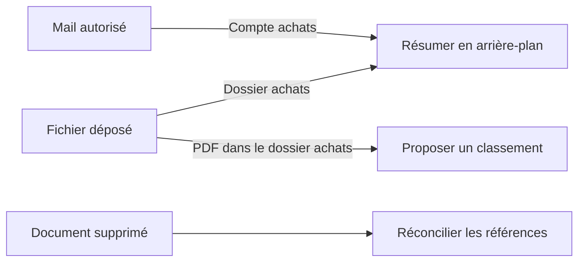

# Dream et graphe des traitements événementiels

Statut `design` · 21 novembre 2026.

Dream devient le **gestionnaire des événements et de leurs traitements**. Les domaines sources confirment les faits, par exemple un mail autorisé, un Document révisé ou un fichier déposé. Dans Dream, un graphe configure les branchements entre ces événements et les traitements disponibles. Le tableau de bord et l’historique existants permettent de suivre le traitement associé à chaque branchement. Les Travaux pourront consommer les faits qui concernent leurs attentes. [Plan Travaux](travaux-et-fusion-des-objectifs.md)

## Ordre proposé

Mettre au propre le déclenchement événementiel avant de l’utiliser pour ouvrir ou reprendre des Travaux. Le premier jalon doit être utile indépendamment des Travaux : un mail autorisé et un fichier déposé déclenchent chacun une règle ciblée dont l’exécution est consultable. La conception de la fiche et le rattachement manuel peuvent avancer en parallèle.

Commencer par inventorier les mécanismes Dream existants. Pour chacun, relever ce qui le rend éligible, son périmètre, son traitement, ses dépendances, son reçu et son comportement en reprise. Identifier les événements qui peuvent le déclencher et les balayages qui servent à découvrir ou réconcilier des données. Mail dispose de reçus d’entrée et d’une admission de tâche. Le catalogue de fichiers utilise déjà un mécanisme Dream de découverte et d’analyse. Documents publie des notifications vers l’interface. Exploiter le registre Dream, ses reçus et ses reprises pour introduire les premiers branchements. Une entrée interactive ou une reprise urgente garde un chemin adapté à son délai. [Registre Dream](../../back/app/dream/registry.py), [Réception Mail](../../back/bridge/mail/inbound.py), [Catalogue de fichiers Dream](../../back/app/dream/mechanisms/file_catalogue.py), [Ordonnancement Dream](../../back/app/dream/scheduler.py)

## Catalogue des événements

| Source | Faits candidats et preuve d’origine |
|---|---|
| Conversation | Un round admis donne le contexte au dispatcher. Un round terminé peut alimenter une action différée telle qu’une projection. Chaque usage se fonde sur le round ou le message canonique et le périmètre de son interlocuteur. [Admission](../../docs/fr/architecture/flows/messaging.md#admission-des-conversations-humaines) |
| Mail | Distinguer « réception journalisée » et « contenu autorisé pour traitement ». Le premier peut fournir le reçu et les métadonnées permises. Les actions sur le corps et les pièces jointes exigent l’autorisation du compte et du reçu. [Réception Mail](../../back/bridge/mail/inbound.py) |
| Document | Distinguer création, révision de contenu et suppression confirmées. Préciser si un changement de classement, d’accès ou de métadonnées justifie son propre type. Galaris émet déjà des notifications UI sur les mutations documentaires. La conception doit qualifier la capture durable au point de mutation. [Notifications documentaires](../../back/app/document/events.py), [Mutations Document](../../back/app/document/resource_service.py) |
| Fichier | Distinguer dépôt géré, nouvelle version, suppression confirmée et première observation depuis un fournisseur externe. Exploiter une notification fiable du fournisseur ou la réconciliation d’un catalogue selon ses capacités. Une découverte initiale indique la première observation. Une suppression externe exige une preuve distincte, par exemple un inventaire complet dans le même périmètre. Une panne, un refus d’accès ou une page manquante laisse l’état indéterminé. [Catalogue Dream](../../back/app/dream/mechanisms/file_catalogue.py) |
| Tâche | Identifier les fins d’exécution susceptibles de déclencher une extraction ou une rétrospective. Qualifier les dépendances avec le classement par Sujet avant de migrer les traitements Dream existants. [Machine d’état Dream](../../docs/fr/architecture/state-machines.md#dream) |
| Process et échéances | Une transition ou un résultat persistant de run peut fournir un fait aux abonnés. Une échéance issue de l’Agenda ou du suivi d’un Travail identifie son occurrence. [Process et Agenda](../../docs/fr/architecture/flows/process.md#déclencheurs-de-calendrier) |

Pour chaque type exposé dans Dream, le catalogue décrit le fait exact, le domaine qui le confirme, les filtres disponibles et les traitements compatibles. Chaque occurrence porte une identité stable, la référence de ressource, une version ou une échéance si pertinente et le périmètre d’origine. Les mutations locales doivent décider ensemble de la persistance du fait et de la mutation. Pour une suppression, conserver au plus un marqueur avec les références et métadonnées autorisées requises pour réconcilier les liens. Une pièce jointe reçue, son dépôt et son import comme Document peuvent être trois faits distincts. La provenance commune permet à une règle visant l’arrivée de la pièce de choisir le fait pertinent ou de reconnaître les observations redondantes.

## Graphe de branchement dans Dream

Le graphe est une vue de configuration des branchements actifs ou suspendus. Les nœuds représentent **des types d’événements** et **des traitements enregistrés**. Une liaison porte le filtre, par exemple le compte Mail ou le dossier, et les paramètres autorisés du traitement. Un événement peut alimenter plusieurs traitements. Un utilisateur habilité peut ouvrir une liaison pour la configurer, l’activer ou la suspendre. Dream vérifie la compatibilité des branchements à l’enregistrement. Un premier graphe peut se limiter aux liaisons directes. Une action qui produit son propre événement ouvre la question des enchaînements et de leurs conditions.

Le tableau de bord Dream prolonge le graphe avec l’état des traitements. Depuis une liaison, on retrouve les occurrences reçues et les traitements lancés, en cours, terminés ou en erreur. Depuis un reçu, on remonte à l’événement, au traitement et à la configuration qui a servi. Étendre l’historique existant avec ces liens. Les résultats de plusieurs branches restent inspectables individuellement, y compris lorsqu’une branche échoue. [API Dream pour le tableau de bord et les reçus](../../back/app/dream/router.py)

## Exécution et reprise des branchements

Les branchements peuvent appeler une action déterministe, demander une analyse différée ou admettre une tâche ordinaire si l’action nécessite un agent. Dream fournit déjà un modèle de mécanismes d’arrière-plan avec disponibilité, réclamation, préparation, application, reçus, leases et reprises bornées. Étudier le réemploi de cette exécution pour l’enrichissement, l’analyse ou la proposition. Qualifier séparément la voie de traitement des entrées interactives et des attentes sensibles au délai. Le Chat garde son dispatcher et l’admission des actions métier passe par les façades qui portent leurs autorisations. [Contrat Dream](../../back/app/dream/contracts.py), [Machine d’état Dream](../../docs/fr/architecture/state-machines.md#dream)

Un résultat incertain issu d’une analyse peut produire une proposition. Avant d’appliquer une action, revérifier la permission d’exécution, la version de la ressource et l’état pertinent. Chaque couple occurrence et branchement retrouve son reçu et, si elle existe, la même tâche après rediffusion. Fixer la portée d’une réexécution volontaire et le sort des actions en attente après modification ou suspension d’un branchement. Éprouver les enchaînements où une action modifie une ressource et produit un nouvel événement, notamment un résumé qui déclencherait à nouveau son propre traitement.

## Qualification progressive

1. **Pilote Mail et Fichier géré.** À partir du catalogue, configurer un branchement pour un compte Mail de test et deux traitements pour les PDF d’un dossier de test. Observer leurs résultats dans le tableau de bord et retrouver leur événement depuis l’historique. Suspendre une branche et vérifier que l’autre continue. Une rediffusion ou un redémarrage retrouve les mêmes exécutions, et l’admission Mail conserve ses autorisations et son comportement existants.
2. **Révisions et suppressions locales.** Qualifier sur un Document la création, la nouvelle version et la suppression confirmée. Un échec de transaction laisse la règle sans fait à traiter. Une analyse portant sur une ancienne révision ne peut écraser le résultat courant. Une suppression déclenche uniquement l’action prévue pour le marqueur restant.
3. **Observation de fichiers externes.** Qualifier un fournisseur surveillé. Vérifier la nouvelle version, l’import, le déplacement, la perte d’accès, la reprise d’un inventaire interrompu et la suppression confirmée. Un même dépôt observé plusieurs fois produit un seul traitement attendu.
4. **Premier consommateur Travail.** Un reçu et sa pièce autorisée peuvent fournir une preuve. Deux chemins d’observation de la même pièce convergent vers une seule action. Le pilote voit le fait arrivé pendant une pause et choisit quand reprendre.

À partir du pilote, migrer les mécanismes Dream par groupes en préservant leurs réglages, leurs dépendances et leurs reçus historiques. Chaque traitement bascule avec une seule voie de déclenchement pour une même occurrence. L’inventaire indique quels mécanismes sont déjà visibles dans le graphe et lesquels restent à qualifier.

## Décisions à instruire

- Choisir le premier catalogue d’événements, le sens de chaque événement et l’autorité qui confirme son observation.
- Définir les responsables des règles, les filtres exposés, l’identité d’exécution, les approbations et le type d’action qu’une règle peut lancer.
- Décider quelles actions partagent l’ordonnancement Dream, lesquelles demandent un autre délai et comment suivre les reçus en échec.
- Définir la corrélation, l’ordre des révisions, la réexécution et la prévention des boucles avant d’autoriser des chaînes d’actions.
