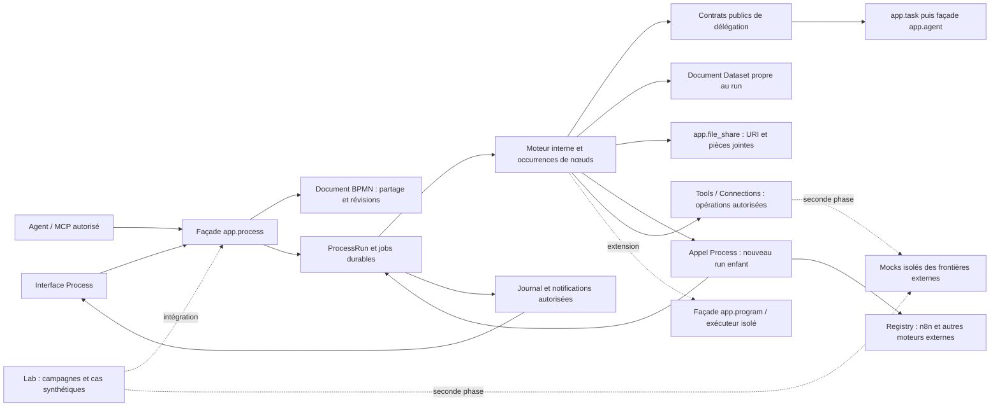

# Processus métier internes, partageables et exécutés depuis la dernière sauvegarde

- Statut : `design`.
- Date : 2026-10-11.
- Demande : internaliser un petit moteur de processus que les agents peuvent créer, modifier et lancer, avec IF, FOR, WHILE, traitement des erreurs, Dataset et pièces jointes par run, édition graphique et suivi en direct.
- Hypothèses de lecture : « FIR » signifie FOR ; « IGM » désigne l'interface graphique d'affichage et d'édition.
- Précisions utilisateur : édition WYSIWYG extensible, métriques des runs actifs et terminés, appels de processus sans profondeur structurelle fixe, maintien durable de n8n et des processus externes.
- Décisions complémentaires : Lab propriétaire des tests, benchmarks et données synthétiques ; mocks d'applications reportés à une seconde phase ; débogage visuel ; reprise des exécutions actives après redémarrage ; parallélisme selon graphe/harnais ; aucun budget Process en v1 ; compatibilité minimale ; inspection/audit MCP autorisés ; secrets exclusivement dans Tools/Connections.
- Simplification v1 : chaque lancement utilise la dernière sauvegarde, sans sélection de version ni rejeu d'une ancienne définition ; historique documentaire consultable/restaurable ; prompt rédigé par Task et contrôle de résultat éventuel à préciser ; visibilité humaine selon propriété, partage et agents gérés ; processus orphelins réservés aux administrateurs humains.
- Périmètre de ce document : proposition de réalisation, sans changement du runtime ni autorisation de déploiement.

## 1. Résultat attendu

Un agent autorisé crée un processus avec un code unique et immuable, un titre et une
première définition. Il assemble des Tasks, des conditions et des boucles, le partage
avec les mêmes personnes et les mêmes règles qu'un document, puis le lance avec un
JSON et des pièces jointes. Chaque lancement possède son Dataset, son historique et
un graphe montrant les étapes en cours. Une modification prépare les prochains runs ;
elle ne change jamais la définition exécutée par un run déjà admis.

La cible est un moteur métier natif supplémentaire dans `app.process`. Le bridge n8n et
les autres moteurs externes restent opérationnels durablement dans le même catalogue.
La reprise, les droits, le journal, les processus imbriqués, les métriques et l'annulation
sont des contrats du premier périmètre, au même titre que l'éditeur WYSIWYG.

| Exigence | Critère de réception |
|---|---|
| Autonomie | Un agent crée, corrige et lance son processus avec ses capacités ordinaires autorisées, sans recevoir `process_admin`. |
| Identité | Code globalement unique pour les processus internes, non modifiable et jamais réutilisé ; titre modifiable. |
| Historique et lancement simple | Historique Document pour consulter/restaurer ; chaque lancement utilise la dernière sauvegarde, sans paramètre ni sélecteur de version. Le contenu démarré est conservé avec le run pour sa reprise. |
| Prompt par Task | Chaque Task lancée reçoit un prompt rédigé depuis l'instruction du nœud, ses entrées et son contexte ; le prompt réellement utilisé est enregistré. Un contrôle métier supplémentaire du résultat reste facultatif et à préciser. |
| Contrôle de flux | IF/ELSE, FOR avec zéro ou plusieurs éléments, WHILE avec zéro ou plusieurs passages et boucles imbriquées fonctionnent. |
| Erreurs | Une erreur capturée prend la branche prévue ; une erreur non capturée termine le run en `error`. |
| Données | Chaque run possède un vrai document Dataset JSON, des entrées figées, un état métier et des résultats lisibles sans troncature silencieuse. |
| Pièces jointes | Entrées obligatoires/facultatives, URI canoniques, contrôle d'accès et conservation intentionnelle des fichiers nécessaires. |
| Partage | Les mêmes ACL et le même formulaire que les Documents régissent les processus internes ; un collaborateur en lecture ne peut pas les modifier ou repartager. |
| Exécution autorisée | Un agent ne lance un processus tiers que si son partage et ses capacités d'exécution l'autorisent. |
| Interface WYSIWYG | Création et édition visuelles complètes, validation, partage, lancement, liste des runs et consultation d'un run actif ou terminé avec annotations extensibles. |
| Imbrication | Un processus lance un autre processus, qui peut en lancer un autre, sans profondeur fixe imposée par le modèle ou l'interface ; récursion autorisée, sans budget Process en v1. |
| Métriques | Durées, attentes et coûts par occurrence, Task induite, sous-processus et run racine ; agrégation sans double comptage et indication des données manquantes. |
| Moteurs externes | Lancement/suivi/annulation n8n conservés ; un processus interne peut appeler un externe via le même registre et les mêmes contrats autorisés. |
| Durabilité | Redémarrage pendant une Task, une branche parallèle ou un appel externe : reprise de la même exécution, sans double effet ni modification d'un terminal. |
| Lab | Le Lab reste le propriétaire des tests, données synthétiques et benchmarks Process ; l'infrastructure v1 prépare son intégration, les mocks d'applications sont une seconde phase. |
| Débogage visuel | Points d'arrêt, pause, inspection et pas à pas autorisés, persistés et retrouvés après redémarrage. |
| Ordonnancement | Une bifurcation parallèle du diagramme rend plusieurs Tasks prêtes ; une dépendance impose leur ordre ; un harnais limité à une Task conserve sa corrélation LLM. |
| Aucun budget v1 | Aucun arrêt ou refus Process selon coût, tokens, durée cumulée, itérations, profondeur ou nombre de descendants ; métriques informatives et annulation explicite. |
| Compatibilité minimale | Refuser une entrée requise absente ou du mauvais type, notamment du texte transmis à un slot image, avant de lancer l'enfant. |
| Inspection et audit | Un agent lecteur obtient la définition complète autorisée et peut la critiquer ; une correction exige l'écriture et la révision attendue. |
| Secrets et API | Les opérations externes utilisent des Tools et Connections ; aucun secret dans le BPMN, les entrées d'agent, l'éditeur ou les résultats MCP. |
| Accès humain | Un utilisateur voit ses processus, ceux partagés avec lui et ceux des agents qu'il gère ; lecture et modification sont autorisées séparément par privilèges et assertions. |
| Processus orphelin | Sans propriétaire humain ou agent actif, la définition n'est visible que des administrateurs humains, même si elle était partagée auparavant. |

## 2. Socle vérifié dans le worktree

| Existant | Source et conséquence |
|---|---|
| Définitions et runs | `back/app/process/models.py` possède déjà `process_definitions`, `process_runs`, `process_run_events` et `process_start_jobs`. Étendre ces tables. |
| Moteurs multiples | `engine.py`, `registry.py`, `interface.py`, `workers.py` : enregistrer un moteur interne, sans remplacer les moteurs externes. |
| États durables | `process_service.py` gère transitions, admission, corrélation, idempotence, annulation, callbacks et attentes Task. Conserver ce propriétaire. |
| Catalogue personnel | `list_for_agent`, `get_for_agent`, `resource_facade.py` filtrent actuellement par affectation `agent_id`. Pour les internes, remplacer ce filtre par les ACL du document lié. |
| Fonctions MCP | `process_*` appartient à `galaris` ; `process_admin_*` appartient à une connexion administrative optionnelle. Étendre le libre-service, sans confondre ces autorités. |
| Documents et Datasets | `back/app/memory/models.py` distingue documents et révisions ; les types activés sont actuellement `html` et `dataset`. |
| Partage réel | `access.py`, `item_sharing.py`, `document_sharing.py` : propriétaire humain ou agent, agents/utilisateurs/groupes, lecture/édition, partage global, appartenances vivantes, contrôle de concurrence. |
| Formulaire commun | `front/core/util/sharing.ts`, `SharingPanel.vue`, `SharingRecipients.vue` existent déjà. Réutiliser ce contrat et ces composants. |
| Accès humain existant | `app.memory.document_sharing.document_actor` distingue lecture/écriture et utilise `AgentManagementScope`. Process possède actuellement `PROCESS_READ`, `PROCESS_LAUNCH`, `PROCESS_ADMIN` et des contrôles de scope dans son router ; prévoir les assertions de ressource et le privilège d'édition nécessaires. |
| Interface Process | `/process`, `ProcessRunsPanel.vue`, `ProcessRunDetailContent.vue` et services associés fournissent un point d'extension. |
| Notifications | `back/app/process/events.py` contrôle actuellement les événements par scope du lanceur. Ajouter les ACL de run pour le nouveau partage. |
| Tasks | `task_service.create(..., idempotency_key=...)` déduplique l'admission ; `app.agent.task_port` et l'adaptateur Task portent les contrats de délégation. |
| Provenance | Les Tasks, appels LLM et Processes conservent requester, portée d'exécution, liens et contrôles durables décrits par la décision 0170. Les étapes doivent en hériter. |
| Coûts et temps disponibles | `app.llm.models.LLMCall` porte `task_id`, `process_run_id`, horodatages, tokens, `cost`, `inference_cost` et `cost_estimated`. `ProcessRunDetail` expose des appels corrélés, mais ne réalise pas encore toute l'agrégation des futurs arbres de runs. |
| Lab synthétique | `app.lab.synthetic_service`, `contracts` et `mechanism_registry` portent génération, campagnes et réponses d'outils enregistrées, dont des admissions Process simulées. Étendre ce socle à l'exécution d'un graphe complet ; elle n'est pas déjà qualifiée par ces simulations. |
| Capacité des harnais | `app.agent.contracts` déclare `max_parallel_tasks` ; le scheduler Task la respecte. `app.llm.runtime_correlation` utilise notamment la Task explicitement corrélée ou l'unique Task sous lease : plusieurs Tasks ne doivent pas rendre cette attribution ambiguë. |
| Budgets Task existants | `app.task.budget` porte des limites opt-in `TASK_ROOT_MAX_*`. Aucun budget Process supplémentaire en v1 ; vérifier que la configuration de réception n'active pas ces limites Task, sans supprimer les politiques explicites d'autres usages. |

Limite actuelle : un document HTML contenant du JavaScript possède un runtime dans le
navigateur du lecteur. Ce n'est pas un exécuteur de scripts serveur. Le plan
[programmes-documentaires-json.md](programmes-documentaires-json.md), également `design`,
propose cette capacité ; sa présence n'en prouve pas la réalisation.

Les fichiers Process, Task et Agent ont des modifications préexistantes. L'implémentation
future devra partir de leurs contrats effectivement retenus et préserver ce travail.

## 3. Architecture proposée



| Propriétaire | Responsabilité |
|---|---|
| `app.process` | Identité, contenu courant validé, orchestration, nœuds, arbres de runs, snapshots de reprise, journaux, métriques et droits d'exécution. |
| `app.memory` | Document BPMN, contenu, ACL, révisions ; documents Dataset et leurs pièces jointes. |
| `app.file_share` | Lecture, écriture et transfert des URI canoniques avec les droits du domaine propriétaire. |
| `app.task` | Admission et persistance des Tasks, scheduler, tentatives, suspension et arrêt. |
| `app.agent` | Contrats publics, délégation et exécution par les drivers existants ; aucune dépendance ajoutée vers Process ou Task. |
| `app.lab` | Cas synthétiques, tests, benchmarks et rapports Process ; mocks d'applications dans une seconde phase, sans deuxième moteur Process. |
| `app.tools`, `app.connection` | Capacités et opérations externes autorisées, paramètres et secrets résolus côté serveur ; extension REST si nécessaire. |
| `app.program`, lorsqu'il existe | Exécution confinée des programmes documentaires et résultat JSON exact. |
| `front/app/process` | Catalogue, éditeur WYSIWYG extensible, lancement, navigation des appels et monitoring annoté ; services API et état partagé appropriés. |

Les interfaces entre domaines passent par les racines publiques ou `contracts`, `facade`,
`interface`. Ajouter des ports ciblés si nécessaire ; ne pas importer le service interne
ou les modèles d'un autre domaine pour piloter son workflow.

### Un processus interne adossé à un document

Ajouter un type documentaire immuable `document_type="process"`, contenant du XML BPMN
UTF-8, édité avec le composant graphique ou un éditeur XML. Il conserve les services
existants de partage, révision, classement et pièces jointes. Son ouverture n'exécute rien.

Chaque définition interne référence exactement un tel document. Les ACL et la propriété
restent celles de ce document : aucune table parallèle de grants Process et aucune copie
périodique de permissions. La façade Memory expose les opérations nécessaires de manière
publique. La page Process utilise le formulaire commun relié aux mêmes services.

Le titre du document est le titre de référence du processus ; un éventuel `label` conservé
pour compatibilité est une projection réconciliable. La propriété du document est l'autorité ;
`agent_id` reste l'affectation historique des moteurs externes, pas un deuxième propriétaire
pour les internes. Éviter deux versions indépendantes de titre, propriétaire ou partage.

Les mutations via `file_*` restent possibles sous contrôle de révision et alimentent la même
validation et le même historique documentaire. Le type `process` est soumis à un validateur public
fourni par `app.process` et enregistré au bootstrap : `app.memory` ne l'importe pas en privé.

## 4. Identité, historique et exécution de la dernière sauvegarde

- `code` est unique dans toute l'instance pour les processus internes, généré par défaut,
  éventuellement fourni à la création sous format contrôlé. Exemple synthétique : `PROC_FACTURES`.
- Le code n'est pas un titre ; renommer, partager ou transférer la propriété le préserve.
- La contrainte d'unicité inclut les définitions archivées. Aucun recyclage après suppression.
- L'API de modification refuse le champ code ; les écritures passent par la même façade.
  Vérifier aussi les jobs de synchronisation et les surfaces administratives.
- `galaris://process/<code>` identifie un interne ; son document conserve `document://<uuid>`.
  Les `workflow_id` des moteurs externes restent valables. Définir un espace réservé et
  vérifier les collisions avant d'exposer ces deux locators dans la même collection.
- Chaque sauvegarde effective crée une révision de l'historique documentaire existant.
  Cet historique permet de voir les différences et de restaurer un contenu antérieur.
  Une sauvegarde identique suit le contrat Document ordinaire.
- Chaque lancement prend la dernière sauvegarde courante et la valide. Aucun choix de
  version, pinning de dépendance, paramètre `process_version_id` ou lancement historique
  n'est exposé dans MCP, HTTP ou l'interface. Un appel enfant suit la même règle au moment
  de son propre lancement ; un nouveau run après erreur utilise aussi le contenu courant.
- Conserver avec le run la référence de la révision documentaire et le graphe utilisés au
  démarrage, pour reprendre et afficher cette exécution après une modification. Une édition
  ultérieure ne change pas un run déjà admis. Cette trace technique ne constitue pas un
  catalogue de versions exécutables ni une option de lancement ; pas de table `ProcessVersion`.
- La version du format `galaris.process/v1` désigne seulement le contrat technique du
  document et du checkpoint, pas une version métier que l'utilisateur doit choisir.
- Un brouillon non exécutable reste éditable et porte ses diagnostics ; le lancer est refusé.
  Aucun retour silencieux vers une ancienne version si le contenu courant est invalide.
- Aucun rituel de publication humaine n'est imposé. Les permissions ordinaires suffisent
  pour sauvegarder un contenu valide et l'utiliser. Une restauration devient la sauvegarde
  courante et crée une nouvelle révision documentaire ; les prochains lancements l'utilisent.

Archiver empêche de nouveaux lancements et garde l'historique. Un run actif poursuit son
contenu de départ. La suppression d'un document de définition ne détruit pas
les preuves de ses runs ; protéger les révisions référencées jusqu'à expiration de rétention.

## 5. Norme et profil BPMN exécutable

La proposition s'appuie sur [BPMN 2.0.2 de l'OMG](https://www.omg.org/spec/BPMN/2.0.2/About-BPMN),
qui fournit la spécification et les schémas XML. Définir un profil Galaris publié et versionné,
limité aux constructions réalisées. Ne pas annoncer la conformité à l'ensemble de la norme.

| Intention | Représentation retenue dans le profil |
|---|---|
| Début et fin | Événements de début/fin simples. |
| Séquence | Flux de séquence avec identifiants stables. |
| Task agentique | Service Task portant l'extension `galaris:kind="task"`. |
| IF / ELSE | Gateway exclusive, conditions explicites et sortie par défaut. |
| Bifurcation / convergence parallèles | Gateways parallèles AND ; une étape suivie de plusieurs branches parallèles est normalisée visuellement en bifurcation explicite. La convergence attend les branches de la même invocation. |
| FOR / FOR EACH | Activité ou sous-processus multi-instance séquentiel sur une collection. |
| WHILE | Activité ou sous-processus avec boucle standard et test avant chaque passage. |
| TRY / CATCH | Sous-processus et événement d'erreur de bordure interruptif ; fin en erreur si non capturée. |
| Appel d'un autre processus | Call Activity avec cible déclarée et extensions Galaris pour résolution interne/externe, mappings, attente et politique d'erreur. |
| Appel d'outil | Service Task de type `tool_call`, utilisant une opération Tools/Connections autorisée ; qualifier ce nœud avec les contrats et tests Tools existants. |
| Programme documentaire | Service Task de type `program`, appelant une ressource externe ; ajout après qualification du moteur Programme. |

Ces correspondances sont basées sur les mécanismes de la
[spécification BPMN](https://www.omg.org/spec/BPMN/2.0.2/PDF). Les paramètres d'agent,
les mappings JSON et politiques de retry sont des extensions Galaris documentées.
Un traitement commun après convergence des branches exprime le nettoyage métier normal ;
un éventuel `finally` garanti après interruption demandera un contrat séparé.

Le XML avec extensions et coordonnées BPMN DI est la source de référence. Un graphe
intermédiaire compilé sert à exécuter et faciliter les appels MCP ; il est dérivé, associé
à une empreinte et ne devient pas une seconde définition éditable indépendamment.

Prévoir deux entrées équivalentes pour les agents : XML complet ou graphe structuré typé
avec `nodes`, `edges`, boucles et politiques. Le graphe produit le même XML canonique.
Un aller-retour interface → MCP → interface préserve le sens, les IDs, les paramètres et
les coordonnées pertinentes. Les exports XML conservent les extensions.

La validation comporte : XML borné sans DTD/entités externes/import réseau ; conformité
structurelle ; profil supporté ; unicité des IDs ; connexions, début/fin, joignabilité,
branches par défaut, boucles structurées et erreurs ; contrats d'entrée/sortie et mappings.
Les bifurcations/convergences AND sont structurées dans la v1 ; un IF ne peut pas laisser
une convergence attendre une branche qui ne recevra jamais de jeton. Diagnostiquer ce cas
à la sauvegarde plutôt que laisser un run bloqué.
Refuser avant tout effet les éléments inconnus ou non exécutables. Les diagnostics identifient
le nœud et le champ à corriger.

Une référence récursive entre définitions est valide : sa présence seule n'est pas une erreur
de validation. Distinguer le cycle d'appel autorisé des cycles de flux internes hors boucles
structurées. Chaque invocation crée une nouvelle identité de run enfant.

### Compatibilité minimale en v1

Déclarer les champs requis et types JSON d'entrée/sortie, ainsi que les slots de ressources
et leurs types de média attendus. Contrôler les incompatibilités évidentes à la sauvegarde
quand les types sont connus, puis les valeurs réelles avant chaque appel : existence,
type, accès et métadonnées vérifiées de la ressource. Une chaîne de texte n'est pas une
image ; une URI n'est acceptable que si elle désigne une ressource image accessible.
L'erreur cite le nœud appelant, le slot et les types attendu/reçu, sans lancer l'enfant.

La v1 n'impose pas de preuve de compatibilité de tout le graphe transitif, de conversion
automatique, de registre universel de types ou de migration automatique des dépendances.
Le contenu courant de l'enfant est suivi de ce contrôle : une modification de sa signature
ne provoque ni lancement incompatible ni repli silencieux sur un ancien contenu.

### Expressions déterministes

Les conditions et mappings utilisent un petit langage déclaratif `galaris.expr/v1` :
références de champs, constantes JSON, comparaison, logique, calculs simples et collections
bornées. Le même évaluateur sert à la validation et au runtime. Aucune exécution de Python
ou JavaScript arbitraire dans une condition.

Définir explicitement absent versus `null`, comparaisons de types, nombres représentables,
ordre d'évaluation et résultat booléen requis. Une erreur d'expression devient une erreur
de nœud identifiable. L'interface construit ces expressions ; MCP accepte leur forme typée.
Des opérations complexes passent par une Task ou, plus tard, un Programme.

Le FOR fige sa collection à son entrée, traite les éléments dans l'ordre et expose index,
élément et variables locales. Le WHILE relit la condition avant chaque itération ; le corps
peut modifier l'état métier. Zéro passage est valide. Les chemins d'itération distinguent
les occurrences imbriquées. Les cycles arbitraires hors boucles déclarées sont refusés.

## 6. Persistance à construire

Les noms suivants sont des propositions de contrat, pas des tables déjà présentes.

| Entité | Champs ou garanties principaux |
|---|---|
| `ProcessDefinition` existante | Nature interne/externe, code interne immuable, FK documentaire unique, état archivé ; champs moteur historiques conservés. |
| Contenu validé / graphe dérivé | Diagnostic et cache de compilation du contenu courant, référencés par empreinte/révision Document ; aucun catalogue indépendant de versions exécutables. |
| `ProcessRun` existante | Référence de révision Document et snapshot du graphe démarré, FK du Dataset unique, lanceur/requester et scope admis, sortie référencée, version technique du checkpoint et pause ; FK nullable `parent_run_id`, `root_run_id` et `caller_node_attempt_id`. Les runs externes gardent leur contrat. |
| `ProcessNodeRun` nouvelle | Run, ID BPMN, chemin d'itération/invocation, état, génération de lease, prochaine reprise, contexte local, jetons de branche/convergence et compteurs. Unicité de l'occurrence. |
| `ProcessNodeAttempt` nouvelle | Occurrence, numéro de tentative, clé d'effet, FK Task, run enfant ou run Programme, révisions Dataset d'entrée/sortie, erreur et reçu ; historique des essais conservé. |
| `ProcessRunEvent` existante | Journal append-only : ordre/cursor durable par run, références d'occurrences, transitions et reçus bornés. Déduplication des événements. |
| Jobs durables | Démarrage existant + travail de progression disponible, lease/génération, retries et wakeups après commit ; séparer lancement du moteur et progression des étapes. |
| Contrôle de débogage | Points d'arrêt liés au graphe du run et aux occurrences, commandes idempotentes de pause/reprise/pas, position consommée et génération d'admission ; contrôle distinct des ACL de lecture. |
| Projections de métriques | Lecture publique et agrégats réconciliables par occurrence, Task, run et arbre ; version du calcul, couverture et curseur des sources. Aucune seconde facturation indépendante des appels physiques. |

Tous les champs en `_id` sont de vraies FK vers des PK de même type. Les identifiants BPMN
ou moteur portent un nom explicite comme `node_key`, `iteration_path`, `external_reference`.
Les modèles déclaratifs, contraintes et actions de conversion passent par DbAdmin.

Les définitions, runs, événements et révisions documentaires suivent une politique explicite.
Les FK et la rétention protègent Dataset, révisions, Tasks et PJ référencés. Les mesures de
stockage couvrent les révisions de Dataset et les nombreuses occurrences de boucle ; prévoir
archivage, pagination et diagnostics de capacité. Aucun quota d'exécution Process en v1.

## 7. Dataset et pièces jointes de chaque run

### Un vrai Dataset documentaire

Créer un nouveau document `dataset` privé au lanceur pour chaque run. Un démarrage ne réutilise
pas le Dataset d'un ancien run. Une relance initialise un nouveau Dataset et conserve son
lien de provenance vers le run précédent.

Chaque run interne enfant possède lui aussi son Dataset : les données se transmettent par
mappings d'entrée/sortie explicites, jamais par partage implicite d'un objet mutable global.
Un run externe conserve son contrat de données actuel ; le parent peut référencer ses
résultats autorisés sans imposer une conversion des workflows n8n existants.

Structure logique initiale :

```json
{
  "format": "galaris.process-run-data/v1",
  "input": {"factures": []},
  "variables": {},
  "results": {},
  "attachments": [],
  "output": null
}
```

`input` conserve l'entrée admise ; `variables` porte l'état métier ; `results` référence
les résultats structurés des étapes ; `output` est la sortie finale. L'historique d'exécution
reste dans les tables Process. Les gros résultats peuvent être des ressources référencées,
avec taille et empreinte, sans les dupliquer à chaque itération. Les boucles possèdent un
contexte local, publié vers le Dataset seulement par des mappings déclarés.

Le moteur est le seul écrivain du Dataset d'exécution. Il utilise une commande publique
interne dédiée, limitée au Dataset exact du run et à ses mappings. Les utilisateurs et agents
peuvent le consulter et, avec l'autorité requise, gérer son partage. Une correction de données
passe par un nouveau lancement ; un terminal est figé. Une copie Dataset reste éditable selon
le contrat ordinaire, mais ne remplace jamais le résultat historique.

Le partage de la définition **ne partage pas automatiquement les données des runs**.
Le Dataset est le support ACL du run, sous les restrictions d'immutabilité d'exécution.
Les étapes déléguées reçoivent uniquement leur entrée autorisée et des références dont elles
ont réellement l'accès ; aucune diffusion automatique de l'intégralité du Dataset.

### Écritures et reprise

Le Dataset est la source métier. Le journal conserve des mutations en attente et leurs reçus,
pas une deuxième copie concurrente de tout son contenu. Comme les services actuels peuvent
committer séparément, ne pas supposer une atomicité inter-domaines inexistante.

Retenir un protocole durable : enregistrer résultat d'étape et commande de mutation avec
une clé unique ; appliquer la mutation par une façade Dataset idempotente, protégée par
révision et reçu durable ; enregistrer ce reçu dans Process ; avancer ensuite le curseur.
Une panne entre ces opérations relit le reçu au lieu de réappliquer la mutation. Tant que
le Dataset n'a pas acquis sa révision attendue, le nœud suivant et le terminal du run ne
sont pas publiés. Les modifications multiples d'une étape sont regroupées en une révision.

Les branches parallèles lisent leur entrée figée et produisent des résultats locaux.
Les sorties sont réunies à la convergence selon des mappings déterministes : champs
distincts, collection ordonnée par branche, ou réduction déclarée. Deux écritures concurrentes
sur la même variable sans règle de fusion sont refusées avec un diagnostic. L'ordre
d'arrivée des callbacks ne décide jamais du résultat ; un verrou Dataset ne couvre pas
toute la durée d'exécution des branches.

Ajouter ce contrat public de reçu à Memory pendant le socle, avec tests de concurrence.
Les notifications suivent les commits ; l'interface affiche une synchronisation en cours
si elle lit le journal avant la matérialisation documentaire correspondante.

Les données métier exactes ne passent pas dans `app.process.sanitizer`, qui masque et
tronque des diagnostics. Conserver son usage pour logs/erreurs/aperçus et retourner des
références Dataset autorisées pour le résultat exact, y compris `null`, `false`, zéro et
clés sensibles synthétiques. Les schémas JSON ont un dialecte explicite, des références
internes seulement et des limites de taille, profondeur et coût de validation.

### Pièces jointes

La définition déclare des slots nommés : rôle, description, obligatoire, multiplicité,
types et limites. Le lancement reçoit une liste d'URI `app.file_share`. À l'admission puis
à la consommation, vérifier existence, accès du bon acteur, taille, type et contrat.

Conserver l'URI d'origine et les métadonnées de provenance. Pour les entrées nécessaires à
un run reproductible, créer une copie durable intentionnelle dans
`document://<dataset-uuid>/attachments/`, immuable, avec empreinte et nom source. Garder
les deux références, sans substituer un chemin local. Les fichiers produits utilisent la
même collection ou un provider explicitement choisi, avec reçu et URI de sortie.

Une copie expose les octets aux lecteurs du Dataset : valider la destination et ses droits
comme une vraie opération de transfert. Elle ne devient pas une conséquence implicite du
partage de la définition. Distinguer fichiers fournis au lancement et modèles attachés au
document de définition ; relire les droits de ces derniers pour le lanceur.

La préparation des copies est un travail durable avant le premier nœud. Un échec ou une
révocation bloque l'exécution et nettoie les copies partielles non conservées. Les gros
transferts restent streamés et bornés ; un chemin temporaire n'est jamais adressable par l'agent.

## 8. Droits : exactement le partage des Documents

Pour les processus internes, le document BPMN porte les mêmes niveaux du formulaire :
privé avec destinataires éventuels, groupes explicites et public à l'instance. Agents,
humains et équipes gardent les mêmes droits lecture/édition et appartenances vivantes.
« Public » ne crée pas d'accès anonyme à Internet.

| Action | ACL de ressource | Contrôle supplémentaire |
|---|---|---|
| Découvrir / lire / exporter la définition | Lecture du document BPMN. | Capacité d'outil ou privilège HTTP approprié. |
| Lancer un nouveau run | Lecture du document BPMN. | `process_start` actif/autorisé, portée admise et, en HTTP, `PROCESS_LAUNCH`. |
| Modifier / restaurer un contenu historique | Écriture du document BPMN. | Capacité d'édition ou privilège HTTP d'édition ; révision attendue. |
| Repartager / gérer les droits | Même autorité propriétaire/gestionnaire/administrateur que les Documents. | Contrôle vivant à chaque appel ; édition seule insuffisante. |
| Lire run, données, PJ, événements et export | Lecture du Dataset exact du run, ou administration explicite du run. | Accès à chaque ressource externe référencée ; aucun droit implicite depuis la définition. |
| Annuler / relancer / déboguer un run | Lanceur, gestionnaire autorisé ou délégation de contrôle explicite. | L'édition documentaire du Dataset n'accorde pas le pilotage du run ; lancement revérifié pour une relance. |
| Administrer globalement | Surface `process_admin_*` et droits administratifs actuels. | Activation vérifiée au moment de l'appel, action auditée et aucune capacité implicite pour les scripts. |
| Voir / réattribuer / archiver un processus orphelin | Administrateur humain uniquement. | Assertion d'acteur humain et `PROCESS_ADMIN` ; une connexion MCP administrative d'agent ne suffit pas. |

Choix proposé : **lecture + capacité de lancement autorise l'exécution**, écriture autorise
la modification. Cela conserve exactement les deux niveaux d'accès documentaire. Un troisième
niveau « exécuter » dans le panneau serait un autre système de partage ; il n'est pas retenu.
Les restrictions de lancement se configurent dans les droits d'outil, RBAC et scope d'exécution.

Le propriétaire n'est jamais accepté d'un paramètre libre MCP : il provient de `ctx.agent_id`.
Les appels humains conservent `HumanActor`, distinct d'un agent géré. Pour le premier parcours
HTTP, la création humaine attribue le document à l'humain authentifié ou à un agent géré
explicitement choisi et autorisé. Le run utilise un agent lanceur choisi dans ce scope ;
enregistrer séparément l'humain demandeur. Élargir le seul droit Document ne permet pas
d'usurper un agent.

### Visibilité humaine, lecture seule et assertions

Le catalogue humain reprend la visibilité des Documents : propriété humaine, partages
directs/groupes/public et périmètre des agents gérés. Réutiliser les façades publiques de
Memory et `AgentManagementScope`, en distinguant accès humain direct et accès via un agent
géré. Le contexte de lecture ne peut pas devenir implicitement un contexte d'écriture.

Conserver `PROCESS_READ`, `PROCESS_LAUNCH`, `PROCESS_ADMIN` et proposer `PROCESS_EDIT` pour
les mutations ordinaires, déclaré dans le module puis généré. Les privilèges donnent la
capacité générale ; les assertions vérifient aussi la ressource exacte et son droit vivant.
Prévoir des assertions de lecture, d'écriture/restauration, de partage, de lancement avec
agent autorisé, et d'administration humaine des orphelins. Les noms et leur composition
suivront les conventions existantes ; un privilège global de lecture ne permet pas de
consulter un processus privé hors scope.

Un utilisateur lecteur peut ouvrir le graphe, ses propriétés et l'historique autorisé en
lecture seule. Déplacement des nœuds, modifications de prompt/mapping, sauvegarde,
restauration et repartage exigent leurs droits distincts. Chaque endpoint vérifie ces
assertions ; désactiver les actions dans l'interface ne remplace pas le refus serveur.
Les données et commandes de run continuent à suivre leurs propres ACL et autorités.

### Processus sans propriétaire

Un processus est orphelin si son document n'a plus de propriétaire humain ou agent actif.
Il quitte immédiatement les catalogues ordinaires, y compris ceux des anciens destinataires
et des managers ; d'anciens grants ou un partage public ne le rendent pas visible.
Seuls les administrateurs humains peuvent le consulter et décider de le réattribuer,
archiver ou supprimer selon les protections historiques existantes. Aucune adoption
automatique par un agent ou par un lancement.

Cette restriction porte aussi sur la définition via Memory, `document://`, File Share,
recherche, exports, notifications et snapshots de graphe. L'appliquer par le contrat public
de ressource documentaire, sans deuxième table de grants ni dépendance privée Memory →
Process. La suppression logique d'un propriétaire conserve définition et historique pour
l'administration. Les runs déjà enregistrés conservent leurs états/preuves ; l'administrateur
dispose des contrôles existants. Une Connection manquante donne un diagnostic de l'opération
concernée, sans transfert automatique de propriété ni nouveaux droits.

Un agent délégataire exécute avec ses capacités actuelles, dans la portée du demandeur et
avec les restrictions du run ; le processus ne lui donne ni secrets ni privilèges de son
auteur. L'agent cible de chaque Task doit être délégable et accéder aux références nécessaires.
Les clauses d'expression ou le XML ne peuvent augmenter aucun grant.

Revérifier les droits après une attente en file ou une autorisation, avant chaque nouveau
nœud et à chaque accès à une ressource. Une révocation empêche de nouveaux effets ; elle
ne retire pas des octets déjà transmis. Conserver la preuve des effets commencés et utiliser
l'arrêt explicite pour les opérations actives. Les lectures, recherches, aperçus, exports,
notifications et projections Memory suivent les mêmes ACL. Ne pas exposer un document de
processus par une ancienne projection privée Source-managed qui ignorerait son partage.

## 9. Moteur durable et types de nœuds

### Ordonnancement

`start_run` du moteur interne crée/réutilise l'identité d'exécution et retourne rapidement.
Un worker de progression réclame les occurrences prêtes par lease court et génération ;
un worker périmé ne peut pas committer après perte du lease. Les attentes libèrent les
ressources et sont reprises par wakeup après commit, avec réconciliation périodique.

Chaque occurrence a une identité `(run, node_key, iteration_path)` ; chaque tentative a
son numéro et sa clé d'effet. Une clé stable de soumission distingue retry technique de
l'admission et nouvel essai métier décidé après une erreur prouvée. Un rejeu avec paramètres
divergents est un conflit, jamais une réutilisation silencieuse.

Pour la Task : enregistrer l'intention, soumettre via le contrat public de délégation avec
idempotence, conserver la FK et attendre son résultat durable. Une panne après admission
mais avant reçu retrouve la même Task. L'étape suit le résultat structuré et les ressources
produites ; une phrase de l'agent ne prouve pas à elle seule un effet métier ou du JSON valide.

Réutiliser les transitions Task/Agent, l'effort, le requester et la portée du run.
Enregistrer le résultat et les ressources produits ; valider les types lorsqu'un mapping
en dépend. Le contrôle métier supplémentaire du résultat est à préciser ci-dessous.
Tester explicitement le cycle Task appelante → Process → Task de nœud sur
le même agent : l'attente ne doit monopoliser ni son slot ni un lease nécessaire à l'enfant.

Le graphe détermine les dépendances dès la v1 : A → B → C impose la série ; une sortie
parallèle A → {B, C, D} rend les trois branches prêtes. Un IF choisit une seule branche.
L'éditeur matérialise cette différence avec les gateways du profil, sans déduire un IF
du seul nombre de flèches. La convergence AND attend les jetons de toutes les branches
de la même invocation et itération, jamais ceux d'un passage précédent. Les FOR sont
séquentiels par défaut ; leur corps peut contenir une bifurcation parallèle.

Lancer les occurrences prêtes selon la capacité effective des agents/harnais, par les
ports existants. Pour un harnais sans corrélation fiable Task ↔ LLMCall, conserver
`max_parallel_tasks=1` ; ne jamais attribuer un appel au hasard. Un harnais correctement
corrélé peut exécuter les branches simultanément. Une saturation met les Tasks prêtes
en file, sans erreur métier ; les chaînes de dépendance conservent leur ordre et les
files restent équitables entre runs.

Une Task parent qui attend ses sous-tâches enregistre durablement attente et checkpoint,
puis libère son slot pour permettre aux enfants de s'exécuter. La libération exige la
fin ou l'interruption confirmée du transport actif : aucun ancien appel LLM ne doit
coexister avec un enfant sur un harnais à corrélation unique. Les descendants nécessaires
au déblocage du parent sont ordonnancés avant sa reprise ; les résultats réveillent
ensuite le parent une seule fois. Qualifier les capacités de checkpoint/reprise et de
réconciliation de chaque driver. Un driver incapable de suspendre un appel actif reste
explicitement en attente d'arrêt confirmé ; ne pas simuler une pause en perdant son état,
relancer ses effets ou changer silencieusement d'agent.

### Reprise après redémarrage, y compris pendant l'exécution

La base conserve la frontière des nœuds prêts, les boucles, jetons de convergence,
tentatives et intentions d'effets, références Task/enfant/externe, reçus Dataset et
commandes de débogage. Aucun état indispensable ne dépend de la mémoire d'un worker.
Après redémarrage, récupérer les leases expirés avec une nouvelle génération, relire
ces preuves et reprendre le même run avec son contenu de départ.

Une Task ou un processus externe déjà admis est retrouvé et observé avec son identité
durable ; un callback perdu est réconcilié par le contrat du moteur concerné. Une opération
active dont l'issue est incertaine attend une preuve avant tout nouvel effet. La reprise
automatique continue dès que les résultats/checkpoints sont réconciliés, sans intervention
pour les cas supportés. Une interruption de Galaris ne recrée ni Task, ni enfant, ni écriture
Dataset. Un worker de l'ancienne génération et un callback tardif ne peuvent avancer deux
fois la même occurrence.

Versionner le format des checkpoints et du graphe compilé. Un redémarrage sur la même
version logicielle est un cas de réception obligatoire ; une mise à jour doit préserver
la lecture des runs actifs, ou prévoir une conversion validée avant bascule. Une version
incompatible produit un diagnostic de reprise, jamais un redémarrage du run depuis le début.

### Décision v1 : aucun budget d'exécution Process

Ne pas créer de plafond Process de coût, tokens, durée cumulée, itérations, transitions,
profondeur ou nombre de runs descendants, ni de budget partagé par la racine. Les métriques
restent observables et ne déclenchent aucun refus, pause ou arrêt sur seuil. Une boucle
non terminante continue jusqu'à son annulation explicite ou une erreur réelle ; les jobs
progressent par petites unités avec rendement équitable, sans boucle active monopolisant
un worker. L'annulation reste disponible à toute profondeur.

Les capacités de concurrence des harnais, leases, protections du parseur, contrats de
transport/stockage existants et délais techniques d'une opération ne sont pas des budgets
cumulés de run. Ne pas ajouter un plafond équivalent sous un autre nom. Les limites Task
opt-in déjà présentes sont inventoriées lors du lot 0 : la configuration de réception
Process doit les laisser désactivées ; une politique globale explicitement activée ailleurs
est signalée comme telle et ne devient pas un budget Process implicite. Tout ajout futur
de budgets Process exigera une nouvelle décision utilisateur.

### Appels de processus et imbrication sans profondeur fixe

Le nœud `process_call`, représenté par une Call Activity, désigne un processus interne ou
externe visible et lançable pour l'acteur du run. Le parent attend le résultat durable de
l'enfant, puis applique ses mappings de sortie ou sa politique d'erreur. Il peut gérer les
PJ selon les mêmes contrats de ressources. Un nouvel enfant peut à son tour appeler un
processus, y compris la même définition : A → B → C et A → B → A sont autorisés.

« À l'infini » signifie une imbrication arbitraire, sans maximum métier fixe de profondeur,
ni pile récursive Python/JavaScript, ni chargement de tout l'arbre en mémoire. Le scheduler
progresse par runs/jobs durables ; la filiation est stockée en relations parent/enfant.
Naviguer, arrêter, réconcilier et agréger l'arbre utilise des parcours itératifs et paginés.
La v1 ne rajoute aucun budget au run racine ou à ses descendants. Une récursion non
terminante peut donc rester active ; sa progression rend la main au scheduler, son état
et ses métriques restent consultables, et son annulation se propage dans l'arbre.

Enregistrer intention d'appel, parent, occurrence appelante, racine et clé d'idempotence
avant admission du run enfant. Une reprise retrouve ce même enfant ; un nouvel essai métier
explicitement admis possède une nouvelle identité. Refuser la réutilisation de clé avec
entrée/cible différente. Le lien d'exécution forme toujours un arbre sans cycle de FK,
même quand les définitions sont récursives. Prévenir toute attente circulaire entre runs
déjà existants ; ne pas rattacher un ancêtre comme son propre enfant.

Un enfant interne prend toujours la dernière sauvegarde courante à son propre lancement,
avec validation et snapshot de reprise. Aucun numéro de version dans le nœud d'appel.
Conserver la référence du contenu effectivement appelé ; le snapshot du parent ne fige
pas les dépendances qui n'ont pas encore démarré. Pour
un externe, conserver son identité/version distante lorsque le moteur la fournit et signaler
son absence. Chaque frontière revalide droits, scope, agent délégué et connexions ; le
partage du parent n'accorde aucun droit sur la définition ou le Dataset de l'enfant.

Erreur enfant connue : propagation vers le CATCH/retry du nœud appelant. Issue distante
inconnue : attente de réconciliation avant toute poursuite ou réexécution. Une annulation
du parent se propage aux descendants ; confirmer leur arrêt selon leurs capacités, y
compris les moteurs externes. Le terminal logique et la preuve d'arrêt restent distincts.
Les reçus de coûts tardifs sont réconciliables sans rouvrir le résultat métier.

### Coexistence avec n8n et les autres moteurs externes

Le moteur interne est une entrée supplémentaire du registry. Conserver les Tools,
connexions, affectations externes, `workflow_id`, API, callbacks, polling, clés d'idempotence
et paramètres n8n actuels. Aucune désactivation, conversion forcée ou dépréciation du bridge
n8n ne fait partie de ce plan. Le catalogue, le lancement et le suivi continuent à proposer
les moteurs externes selon les droits existants.

Un appel interne → n8n utilise la façade Process et l'adaptateur existant. La filiation
ajoute la corrélation parent/enfant sans changer les contrats des anciens appelants. Un
workflow n8n autorisé peut aussi lancer un interne via les API/MCP Galaris ; tout lien au
run parent est vérifié côté serveur, jamais accepté comme autorité depuis un identifiant
libre envoyé par le workflow. Un callback de progression n'est pas un droit de lancement.
Tester les chaînes interne → n8n → interne avec les capacités effectivement configurées.

### Erreurs, retry et arrêt

- Erreur structurée : code, nœud/occurrence, tentative, cause bornée et issue de l'effet.
- Un CATCH sélectionne les erreurs déclarées et peut produire une valeur ou poursuivre une
  branche de récupération. Conserver l'erreur dans le journal même si le run réussit ensuite.
- Si un CATCH interruptif couvre plusieurs branches, fermer leurs admissions et confirmer
  l'arrêt ou la fin de leurs effets déjà lancés avant d'admettre la récupération. Invalider
  les jetons de cette invocation ; une issue inconnue d'une branche garde l'ensemble en
  réconciliation. Un CATCH local à une branche peut produire sa sortie puis rejoindre
  normalement les autres branches.
- Le retry a un nombre d'essais et un backoff bornés. Seuls un rejet avant effet, une opération
  idempotente ou un reçu réconcilié autorisent un nouvel essai automatique.
- Une issue inconnue bloque le nœud pour réconciliation. Ne pas la convertir en erreur banale
  capturée puis poursuivre comme si aucun effet n'avait eu lieu.
- La politique de retry déclarée borne les essais d'une opération ; elle ne constitue pas
  un budget cumulé du processus. Les protections de parsing et contrats de transport existants
  restent explicites ; aucun plafond Process de durée, coût, itérations ou descendants en v1.
- L'annulation du run arrête les nouveaux nœuds, demande l'arrêt des Tasks/Programmes et runs enfants liés
  et attend leur confirmation. `cancelling` reste distinct d'un arrêt physique confirmé.
- Réutiliser `queued`, `running`, `waiting`, `unknown`, `cancelling` et les terminaux existants.
  Les motifs d'attente et les états internes de nœud enrichissent l'activité sans multiplier
  inutilement les statuts publics. Documenter tout changement réellement nécessaire.
- Un résultat terminal est immuable. Les callbacks tardifs conservent, si utile, un reçu
  d'observation technique sans remplacer sortie/statut. Appliquer aussi le contrôle 0170
  d'arrêt confirmé avant remplacement.
- Une reprise technique conserve le même run/contenu de départ/identité d'effet ; un nouveau lancement
  après erreur crée un autre run, son Dataset et une provenance explicite.

### Prompt par Task et contrôle éventuel du résultat

Chaque nœud Task porte une instruction éditable et les informations utiles à la rédaction
du prompt : objectif, entrées mappées, contexte autorisé, URI/PJ nécessaires et résultat
attendu. À chaque occurrence lancée, rédiger le prompt concret pour cette Task ; une boucle
utilise l'élément de l'itération, et chaque branche dispose de son propre contexte.
Conserver le prompt réellement transmis dans la Task/tentative et le rendre consultable
sous les droits du run. Une reprise de la même tentative réutilise ce prompt enregistré.

S'appuyer sur la préparation Task/Agent existante et respecter le format éditorial HTML
de l'objectif Task. L'instruction et l'aperçu du prompt sont éditables dans le panneau
WYSIWYG, sous droit d'écriture. Les secrets et le Dataset complet ne sont pas injectés
implicitement. Le lot 0 précisera l'assemblage depuis le nœud et le contexte ; une rédaction
supplémentaire par un modèle n'est pas imposée à chaque lancement dans la v1.

Enregistrer le statut Task, son résultat et les références produits constitue le socle.
Les mappings nécessitant un champ JSON ou une image conservent leur validation minimale.
Un contrôle métier supplémentaire est éventuel : règle déterministe, étape de revue ou
critique agentique selon le besoin. Sa forme et l'action en cas de résultat insuffisant
restent à réfléchir ; aucun juge LLM ni double exécution systématiques en v1. Distinguer
une Task terminée et une appréciation métier du résultat, sans créer un deuxième workflow
de supervision obligatoire avant de livrer l'infrastructure.

### Nœud Programme documentaire

Le registre de nœuds expose un contrat commun : schémas, préparation autorisée, démarrage,
observation, annulation, résultat et capacités d'idempotence. Livrer d'abord `task`, `process_call`, `tool_call` et les
nœuds déterministes de contrôle ; ajouter `program` dès que l'exécuteur est qualifié.

Le nœud Programme appelle la façade proposée par le plan Programmes. Il ne lance pas le
JavaScript HTML du navigateur sur le backend et n'exécute pas une commande shell contenue
dans le BPMN. Le code de programme reste dans son document et son moteur isolé.

Respecter le contrat de ce plan : **dernier contenu sauvegardé au démarrage effectif de
chaque calcul**, sans paramètre public de choix d'ancienne révision Programme. Le graphe
Process est figé, mais un Programme modifié avant une étape peut donc changer cette étape.
Conserver URI et empreinte du code réellement exécuté et afficher cette différence de
provenance. Une reprise du même calcul conserve son contenu initial ; un nouveau calcul
relit le document. La reproductibilité complète d'un run mixte n'est pas promise sans
contrat futur distinct accepté pour les Programmes.

### Tools, Connections et opérations REST

Les Tasks et nœuds `tool_call` passent par les capacités et contrats publics Tools.
La Connection fournit côté serveur l'URL de service, l'authentification et les paramètres
de connexion ; l'agent ne reçoit que les opérations et schémas autorisés. Le processus
référence une opération et ses arguments métier, jamais un secret, un header d'authentification
ou les paramètres privés de connexion. Les modes Actif/Bloqué/Sur demande et droits du
délégataire sont revérifiés avant l'effet, y compris après une autorisation en attente.

Si le catalogue existant ne couvre pas une application REST, étendre Tools avec un
adaptateur d'opérations déclarées : méthodes/routes, schémas JSON et fichiers, erreurs,
pagination et capacités d'idempotence. L'administration configure la Connection ; une
définition Process ne peut pas substituer un hôte ou des credentials via ses mappings.
Le moteur ne possède pas un deuxième client HTTP générique contournant Tools.
Les journaux, définitions inspectables et métriques ne recopient aucun secret ; cette règle
s'appliquera aussi aux futurs mocks du Lab.

Enregistrer intention et reçu d'effet comme pour une Task. Sans idempotence ou preuve
d'échec avant effet, une réponse REST perdue devient une issue à réconcilier, pas un
nouvel appel automatique. Les futurs mocks Lab couvriront cette frontière en seconde phase.

## 10. Fonctions MCP et API

Les noms nouveaux ci-dessous sont proposés. Conserver les fonctions et signatures historiques
là où possible, notamment `workflow_id`, et résoudre le code d'un interne dans la façade.

| Fonction | Usage |
|---|---|
| `process_list`, `process_get` | Découvrir les internes lisibles et les externes affectés ; retourner code, titre, modification courante et droits effectifs. |
| `process_definition_read` | Lire la définition courante complète autorisée : XML, graphe typé, instructions/prompts, schémas, mappings, politiques d'erreur, cibles et diagnostics. Fournir une ressource paginable si volumineuse, sans troncature silencieuse ni secrets. |
| `process_create` | Créer l'identité et le document, avec XML ou graphe structuré, schémas et slots d'entrée. |
| `process_update` | Sauvegarder titre/définition sous `expected_revision`, valider et alimenter l'historique Document. |
| `process_validate` | Diagnostiquer une proposition ou le contenu courant sans lancer de Task ni d'effet métier. |
| `process_history` | Consulter l'historique documentaire autorisé et les différences ; aucun choix de version à exécuter. |
| `process_restore` | Restaurer un contenu historique comme nouvelle sauvegarde courante, avec droit d'écriture et contrôle de concurrence. |
| `process_sharing`, `process_share` | Adaptateurs vers les mêmes contrats documentaires de consultation et modification des grants. |
| `process_archive` | Empêcher de nouveaux lancements sans supprimer l'historique. |
| `process_start` | Nouveau run avec données, URI PJ et clé d'idempotence existante ; toujours la dernière sauvegarde courante, sans paramètre de version. |
| `process_list_runs`, `process_get_run`, `process_analyze_run` | Suivi filtré par ACL du run ; données exactes référencées, événements paginés. |
| `process_run_children`, `process_run_metrics` | Parcourir les enfants par page et lire les métriques propres/agrégées autorisées, leur couverture et leur fraîcheur. |
| `process_cancel_run`, `process_retry_run` | Commandes personnelles/de contrôle autorisées ; nouveau lancement avec contenu courant pour une relance. |
| `process_pause_run`, `process_resume_run`, `process_step_run`, `process_breakpoints_update` | Contrôles de débogage autorisés, ciblant run/occurrence avec clé de commande et état attendu ; pas de privilège depuis la simple lecture. |
| Capacités Lab à étendre progressivement | Génération de cas/campagnes et lecture des résultats sous droits Lab et Process ; création de mocks d'applications en seconde phase. |
| `process_admin_*` | Administration distincte conservée, sans la rendre obligatoire pour l'autonomie. |

Les fonctions ordinaires suivent les modes Actif/Bloqué/Sur demande, leur cascade globale/agent,
la projection du toolset et les descripteurs d'effet. Les mutations résolvent leurs cibles
canoniques avant autorisation et les revérifient après attente. Un accord ciblé ne s'étend
pas à un autre document, agent ou run. YOLO ne contourne aucune ACL.

`process_definition_read` rend possible l'audit par un agent : examiner le flux, repérer
une branche inaccessible, une incompatibilité d'entrée ou un comportement risqué, et proposer
une correction. Les dépendances directes sont identifiées ; lire leur contenu exige leurs
propres ACL. Une définition parent lisible n'expose ni la définition complète d'un enfant
privé, ni ses données de run, ni ses paramètres Connection. Les diagnostics ne révèlent pas
de métadonnées privées supplémentaires.

La critique argumentée et ses preuves sont conservées dans un Document d'audit, lié à la
révision documentaire examinée et aux campagnes Lab éventuelles. Pas de nouveau moteur LLM d'audit dans
Process : l'agent utilise inspection, validation et Lab. Un agent lecteur peut proposer une
correction ; seul un agent écrivain peut l'appliquer avec `process_update(expected_revision)`.
Une correction sauvegarde un nouveau contenu courant et ne reconfigure pas un run actif. Aucun audit
ne confère automatiquement un droit d'édition, de partage ou de lancement.

En conversation, `conversation_process_start` reste le lanceur asynchrone et conserve le
lien au round/outbox. La création ou modification longue d'un processus passe par une Task
autosuffisante selon la politique conversationnelle ; ne pas monter toute l'édition comme
capacité directe du contrôleur voix/texte. En Task, le lancement conserve l'attente durable.

Le catalogue injecté dans les prompts et la projection `galaris://process/` utilisent la
même visibilité vivante et les mêmes fonctions autorisées. La recherche ne révèle pas
les titres ni le nombre des processus non accessibles. Éviter un double classement entre
le document BPMN et sa projection Process dans la découverte métier.

HTTP conserve `/api/processes/...` et étend les endpoints d'historique, validation, partage,
occurrences, événements, filiation et métriques. Pagination par défaut 50, choix `[10, 20, 50, 100, 500]`, API
acceptant 500. Les paramètres de mutation incluent révision/commande attendues quand nécessaire.

## 11. Interface WYSIWYG extensible, runs et métriques

### Catalogue et fiche

Étendre `/process` avec filtres interne/externe, titre/code/propriétaire, accès effectif,
dernière modification, état et dernier run visible. Actions : créer, ouvrir, modifier, partager,
lancer, consulter l'historique, restaurer et archiver selon les droits. Vue humaine en lecture
seule lorsqu'aucune écriture n'est autorisée ; section des orphelins réservée aux administrateurs
humains. Les runs d'autrui ne contribuent
pas à un compteur ou un « dernier résultat » sans autorisation.

Prévoir des pages dédiées de détail/édition et de run sous `pages/`, avec routes basées sur
les fichiers. Conserver les parcours n8n existants. L'éditeur possède graphe, palette limitée
au profil exécutable, panneau de propriétés, schémas/mappings et diagnostics cliquables.
Créer, déplacer, relier, supprimer et configurer les nœuds directement dans le graphe,
avec sélection, zoom, déplacement du canevas, annuler/rétablir et raccourcis clavier.
IF, FOR, WHILE et appels de processus doivent pouvoir se construire et se configurer
sans écrire du XML à la main. Le choix d'une cible d'appel filtre les processus autorisés
et montre code/moteur et contrat courant ; aucun sélecteur de version. Les prompts de Task,
mappings et politiques d'erreur ont des contrôles visuels.
La vue Source reste une possibilité avancée, reliée à la même définition sauvegardée.

[bpmn-js](https://bpmn.io/toolkit/bpmn-js/) est un candidat pour le visualiseur et l'éditeur :
il permet l'intégration et l'extension de diagrammes BPMN. Le moteur durable reste Galaris.
Qualifier import/export, extensions, règles de palette, poids, licence/attributions et usage
clavier avant de retenir la dépendance et une version verrouillée.

Sauvegarde avec révision attendue, brouillon local préservé en cas de conflit, diagnostics
explicites ; jamais d'écrasement automatique du travail d'un autre collaborateur. Le partage
réutilise `SharingPanel` et les endpoints du document lié.

### Architecture extensible de visualisation

Utiliser un même composant de graphe pour édition de définition, run live, historique et
comparaison de runs, avec un contexte explicite. Séparer le modèle BPMN sauvegardé des
annotations d'observation : un badge de coût ou un état de run ne modifie jamais la
définition ni ses coordonnées. Dans une vue de run, l'action d'édition ouvre une nouvelle
révision de définition ; elle ne reconfigure pas les étapes déjà admises.

Prévoir un registre de contributions typées par type de nœud et contexte : propriétés
éditables, badges/overlays, infobulles, panneaux de détail, colonnes et métriques. Il permet
d'ajouter temps, coût, tokens, tentative, agent, documents produits ou mesures métier sans
réécrire le canevas. Ces contributions sont du code applicatif validé et ne permettent
pas à une définition Process d'injecter du JavaScript arbitraire dans l'interface.

Chaque métrique fournit clé, unité, valeur/disponibilité, horodatage, provenance, couverture
et mode d'agrégation. L'utilisateur peut choisir les annotations visibles et retrouver
son réglage de présentation ; ces préférences ne changent pas le workflow. Les données
d'observation se chargent par page/sélection et par batch, avec cache lié à acteur/run/révision.

Déplier un appel montre les occurrences de ses enfants, un fil d'Ariane et un retour au
parent ; charger les niveaux à la demande. Une définition récursive apparaît comme une
référence ouvrable et ne produit jamais une expansion graphique infinie. Une occurrence
réelle terminée ou active reste sélectionnable à n'importe quel niveau de l'arbre autorisé.
Les runs n8n ont les mêmes vues d'état/métriques disponibles ; lorsque le moteur ne fournit
pas de graphe, présenter le nœud externe et ses détails, avec un lien autorisé vers son outil
source. L'édition WYSIWYG native concerne les définitions internes ; les workflows externes
conservent leur édition dans leur moteur.

### Durées, coûts et métriques des runs

| Mesure | Contrat d'affichage et de calcul |
|---|---|
| Temps écoulé | Admission → instant courant ou fin, pour run, occurrence et Task ; l'horloge du client n'est pas l'autorité. |
| Temps d'exécution | Temps actif mesuré, séparé de file, attente enfant, autorisation, pause et backoff ; préciser les segments effectivement observés. |
| Durée d'appel | Temps où le parent attend le sous-processus, distinct du temps propre et des durées internes de l'enfant. |
| Coût par Task induite | Appels physiques appartenant à cette Task et ses tentatives ; détail des descendants délégués et total inclusif présenté séparément. |
| Coût par nœud/itération | Coût propre et coût de ses Tasks/runs descendants, rattachés à l'occurrence exacte plutôt qu'au seul ID BPMN. |
| Coût du run/arbre | Coût propre, coût des descendants et total inclusif ; agrégations par processus et contenu effectivement démarré sur les runs visibles. |
| Autres mesures | Tokens, appels, tentatives, taux d'erreur, itérations, volumes/PJ et métriques métier déclarées avec unité et origine. |

`LLMCall` reste la source des coûts LLM : distinguer `cost` facturé et `inference_cost`
comparable, ainsi que estimation et montant fourni. Un abonnement peut avoir un coût
facturé nul sans valeur d'inférence nulle. Les coûts de scripts, infra ou services externes
sont des catégories distinctes uniquement lorsqu'une source mesurable existe.

Chaque appel physique est imputé une seule fois à son propriétaire direct. Dédupliquer
par identité d'appel, pas par label Task ou nœud. Les agrégats inclusifs réutilisent cette
filiation sans additionner simultanément le total d'un enfant et ses appels déjà présents
dans le parent. Conserver les retries, appels en erreur et consommations partielles.
Les Tasks créées indirectement par une Task de nœud gardent sa provenance vers l'occurrence
et le run ; une corrélation LLM cumulative Task/Process ne crée pas deux dépenses.

Une durée parent n'est pas la somme des durées enfants si des périodes se chevauchent.
Calculer les intervalles appropriés et afficher séparément temps mural et temps cumulé
de travail. Conserver la devise/unité ; ne jamais additionner des montants de devises
différentes sans conversion explicite sourcée. Pour n8n, utiliser les mesures fournies ou
les appels corrélés Galaris, sans prétendre mesurer les dépenses distantes non exposées.

Les métriques sont mises à jour pendant le run et restent consultables après son terminal,
avec chronologie, détail des Tasks induites et comparaison entre runs et contenus démarrés. Un coût
final reçu tardivement actualise l'agrégat avec sa date de calcul sans rouvrir le résultat
métier. Une source absente est « indisponible » ou « partielle », jamais un zéro inventé.
Les projections sont reconstruisibles depuis les sources durables et ne remplacent pas
le journal d'exécution ou de facturation.

Les ACL s'appliquent aussi aux agrégats : ne pas dévoiler nom, nombre, coût ou durée d'un
enfant inaccessible. Retourner le sous-total visible avec couverture signalée, ou exiger
les droits complets pour le total de l'arbre. Révoquer un accès invalide aussi les caches
de métriques et les comparaisons historiques correspondantes.

### Lancement et Dataset

Formulaire généré depuis le schéma d'entrée, possibilité d'éditer du JSON, sélection de PJ
par slot et choix d'agent lanceur autorisé. Un seul bouton de lancement utilise la dernière
sauvegarde courante. Une soumission retourne le run enregistré en BDD. Si la réponse réseau
n'arrive pas à l'appelant, retrouver ce run par les mécanismes de consultation et d'idempotence
existants ; aucune nouvelle infrastructure dédiée à ce cas ni sélection de version historique.

### Run en direct

Afficher le graphe du **contenu effectivement démarré**, les occurrences/itérations, nœuds actifs,
attentes, retries, erreurs capturées, étapes sautées et terminaux. Ajouter le Dataset courant,
les entrées, sorties, PJ, Tasks et provenance Programme, journal paginé et actions autorisées.
Un nœud réutilisé dans une boucle montre ses occurrences, pas un seul état écrasé.
Les overlays sélectionnés affichent notamment durée, coût propre/inclusif et tentatives.
Ouvrir une occurrence révèle ses Tasks induites et runs enfants, actifs ou terminés, avec
leurs métriques et leurs liens de navigation selon les droits effectifs.

Réutiliser les activités Task et les notifications Process. Les notifications portent IDs,
séquence/révision et références compactes ; les détails sensibles se chargent sous ACL.
Snapshot à l'ouverture et reconnexion, puis événements après curseur ; un trou déclenche une
resynchronisation. Rejeter doublons, événements périmés et réponses d'une ancienne session/run.
Une révocation coupe le flux et vide les données locales devenues inaccessibles.

Fermer la page ou son abonnement n'annule pas le run. La réouverture retrouve son état durable.
Les abonnements/timers sont libérés. Prévoir chargement, vide, erreur, retry, édition conflictuelle,
clavier et présentation utilisable sous 1024 px avec alternative en liste pour le graphe.
Les couleurs suivent Solaire ; les états ont aussi texte/icône. Toutes les chaînes sont FR/EN.
Les modales gardent leur fermeture par backdrop et leur bouton accessible.

### Débogueur visuel

Sur le graphe d'un run autorisé, poser un point d'arrêt **avant** une occurrence, suspendre
la progression, inspecter entrées/sorties/variables et poursuivre ou avancer d'une occurrence.
Dans une boucle, choisir une itération ou un point d'arrêt récurrent. Montrer les branches
prêtes, actives et en attente de convergence, ainsi que la raison d'une sérialisation imposée
par le harnais. Les utilisateurs en lecture disposent de l'inspection ; le pilotage exige
l'autorité de contrôle du run.

La pause ferme durablement l'admission de nouveaux nœuds du run visé. Une action déjà
admise peut finir et son reçu est enregistré ; la pause n'est affichée comme effective
qu'à la frontière d'admission confirmée. Afficher séparément les descendants encore actifs ;
ne pas promettre une suspension physique de toute l'arborescence. Les Tasks utilisent leur
checkpoint et la capacité réelle de suspension du driver. Le pas à pas admet une seule
occurrence choisie parmi les prêtes, puis revient à l'attente ; les descendants requis
pour terminer cette occurrence sont autorisés à progresser et ne restent pas bloqués
derrière le parent en pause. Aucun pas ne remplace un résultat ou ne modifie le Dataset.

Points d'arrêt, position consommée et commandes sont persistés. Une double commande ou
un redémarrage ne produit pas deux pas, et reprendre ne retombe pas immédiatement sur le
même point d'arrêt déjà consommé. La pause du débogueur reste distincte de l'attente du
parent nécessaire à l'ordonnancement des sous-tâches. Modifier des entrées pour explorer
un autre scénario crée un nouveau run ou un cas Lab ; un historique terminé reste intact.

### Lab : socle d'abord, mocks d'applications en seconde phase

Le [plan Lab](lab-evaluation-mecanismes-ia.md) reste propriétaire des tests de processus,
de la génération synthétique et des benchmarks. Réutiliser le moteur et les ports Process,
les campagnes et données synthétiques existantes. La v1 livre d'abord l'infrastructure
Process, les accès publics, les résultats et métriques exploitables par le Lab ; intégrer
des campagnes simples lorsque ce socle fonctionne, sans nouveau moteur de simulation.
Les données et PJ de réception sont synthétiques. Les tests DB, de droits et de reprise
ne dépendent pas d'un catalogue de mocks d'applications.

Tout lancement, y compris depuis le Lab, utilise le contenu courant. Conserver la révision
Document et les paramètres réellement utilisés avec les résultats pour comparer les
campagnes enregistrées ; aucune option permettant d'exécuter une ancienne définition ou
de figer ses dépendances. Une restauration documentaire remet un ancien contenu en courant
avant un éventuel nouveau lancement. Le Dataset d'exécution reste distinct du dataset de
test Lab, et chaque cas dispose de ses propres données. Les mesures du Lab ne créent
aucun budget d'exécution Process.

La création et la simulation de mocks d'applications externes sont explicitement reportées
à une seconde phase. Celle-ci pourra ajouter réponses typées, état synthétique, fichiers,
délais/erreurs, callbacks et journal d'effets à la frontière Tools/Process. Les cas/mocks
seront conservés avec leur configuration ; leur activation restera contrôlée par le Lab,
isolée des exécutions métier et sans repli implicite vers une application réelle.
La conformité de ces mocks aux vrais contrats, les simulations complètes et les campagnes
hybrides seront étudiées à ce moment-là. Elles ne conditionnent pas le démarrage de la v1.

## 12. Lots et ordre de réalisation

Chaque lot termine par son parcours de réception avant d'élargir les consommateurs.

| Lot | Livrables | Réception |
|---|---|---|
| 0 — Contrats du socle | Profil BPMN v1, matrice de droits humains/agents/orphelins, lancement courant uniquement, préparation du prompt Task, Dataset et capacités des harnais ; prototype WYSIWYG simple. | Start → Task → End représentable, historique Document réutilisé, aucune version à choisir, séparation lecture/écriture définie ; forme du contrôle métier éventuel du résultat laissée à préciser. |
| 1 — Définitions et partage | Type Process, code, liaison 1:1, historique Document, CRUD/validation/archive, privilèges/assertions, ACL et façade. | Propriété humaine/agent, partages et agents gérés ; lecteur humain sans mutation, orphelin réservé aux administrateurs humains, conflit et code immuable. |
| 2 — Admission et données | Extensions Run, Dataset propre, PJ/slots, contenu courant au lancement et snapshot de reprise, idempotence existante. | Lancement JSON/PJ sans sélection de version ; contenu courant invalide refusé ; copie autorisée, échec d'entrée sans Task et contenu admis conservé pendant la file. |
| 3 — Parcours vertical Task | Moteur, occurrences/jobs, prompt rédigé et enregistré par Task, délégation et attente ; UI minimale. | Start → Task → End depuis MCP/UI, prompt contenant le contexte attendu, résultat enregistré, reprise après crash ; contrôle métier supplémentaire facultatif. |
| 3 bis — Tools et frontières externes | Nœud Tool, opérations REST si nécessaires, accès via Tools/Connections et contrats publics. | Opération autorisée, secret non exposé et droits revérifiés ; pas de système de mocks d'applications à construire dans ce lot. |
| 4 — Flux, parallélisme, appels et erreurs | IF, FOR, WHILE, bifurcation/convergence AND, files par capacité de harnais, suspension/reprise du parent, `process_call` interne/externe, récursion, compatibilité minimale, erreurs/retry et arrêt des descendants. | A → {B,C,D} parallèle ou sérialisé selon harnais, convergence sans confusion d'itération, parent/enfants sur un slot, A → B → A terminant, interne → n8n → interne, refus image/texte, reprise active sans double effet, boucle persistante annulable sans budget. |
| 5 — Autonomie MCP et consommateurs | Fonctions personnelles, lecture de définition courante/audit, édition sous révision, historique/restauration, débogage, prompt/catalogue, Chat/Task et File Share. | Lecteur inspectant/proposant, écrivain corrigeant, tiers refusé ; lancement courant uniquement, orphelins invisibles aux agents y compris via les projections. |
| 6 — WYSIWYG, débogueur, métriques et live | Édition, prompts, overlays, historique/partage, Dataset/PJ, arbre, points d'arrêt/pause/pas, métriques et reconnexion. | Parcours humain lecture seule et édition autorisée, lancement simple, badges, pause/reprise/pas, coûts sans double comptage, actif/terminé, sauvegarde/conflit, live, clavier/mobile. |
| 7 — Exploitation et premières campagnes Lab | DbAdmin, n8n, rétention, diagnostics, docs FR/EN, essais de reprise et intégration Lab simple sur données synthétiques ; validation finale. | Contrats existants préservés, reprise pendant exécution, corrélation des harnais, droits, métriques accessibles au Lab et absence de budget Process ; aucun mock d'application requis. |
| 8 — Nœuds Programme | Dépend des lots moteur du plan Programmes ; adaptateur, mapping JSON, provenance/annulation. | Process mixte Task → Programme, code courant au démarrage de l'étape, droits distincts, résultat exact et arrêt physique. |
| Seconde phase — Mocks Lab | Création de mocks d'applications, simulations et campagnes hybrides ; détails après livraison du socle. | Mocks sous droits Lab, état isolé, contrats vérifiables, résultats interprétables et absence de repli réel implicite. |

Les lots 0 à 7 forment le premier produit complet : les agents disposent déjà d'un outil
métier autonome avec Tasks, IF, FOR, WHILE, parallélisme selon le graphe et le harnais,
appels imbriqués internes/externes, erreurs, opérations Tool, partage, éditeur WYSIWYG,
débogueur, métriques, suivi live/historique et accès Lab pour tests/benchmarks simples, sans
budget Process ni mocks d'applications en v1. Le lot 8 ajoute les scripts évoqués et doit
être coordonné avec le plan Programmes, sans prétendre
que son exécuteur existe aujourd'hui. Les lots sont des portes de réception, pas une
estimation calendaire ; les prototypes du lot 0 permettront de chiffrer la réalisation.

Extensions ultérieures : FOR multi-instance parallèle, déclencheurs calendrier/webhook,
compensation métier, compatibilité transitive avancée et autres types de nœuds ; mocks Lab
en seconde phase et contrôle métier supplémentaire des résultats à préciser. Ces extensions
exigent des contrats d'ordonnancement, permissions et effets spécifiques. Les budgets
Process sont explicitement hors v1 et ne seront ajoutés que sur nouvelle décision.

## 13. Validation et mesures

Réutiliser la couverture existante avant d'ajouter des scénarios. Les tests protègent les
contrats durables et les effets ; ils ne figent pas positions, tailles ou source de l'éditeur.

| Contrat | Scénarios de référence |
|---|---|
| Profil et compilation | Aller-retour XML/graphe, IDs préservés, XML malveillant borné, éléments non supportés, branches/fin inaccessibles, mappings invalides. |
| Expressions et flux | Absent/null/faux/zéro, types incompatibles, FOR vide, collection figée, WHILE initialement faux, boucles imbriquées et convergence après erreur. |
| Parallélisme | A → {B,C,D}, dépendances sérielles, IF exclusif, AND dans une boucle, convergence structurellement impossible refusée, CATCH local/global avec autres branches actives, callbacks hors ordre, fusion déterministe et conflit de variable refusé. |
| Harnais et sous-tâches | Driver corrélé à plusieurs Tasks, driver à slot unique, absence d'attribution ambiguë, parent en attente/checkpoint puis reprise unique, transport actif encore ouvert, équité entre runs. |
| Historique / contenu courant | Deux éditeurs concurrents ; lancement du dernier contenu courant uniquement ; aucun paramètre de version ; contenu invalide refusé ; snapshot conservé après édition/reprise ; restauration devenant courante. |
| Prompt et résultat Task | Prompt propre à chaque occurrence/itération, contexte mappé et PJ autorisées, prompt enregistré réutilisé à la reprise, résultat/ressources persistés et types requis par les mappings ; contrôle métier supplémentaire à qualifier s'il est retenu. |
| Partage identique | Réutiliser/paramétrer les tests Document : agents/humains/équipes/public, membres changés, lecture/édition, propriétaire humain, refus de repartage par un éditeur, stale lock atomique. |
| Utilisateurs et assertions | Propriété humaine, partage direct/groupe/public, processus des agents gérés ; lecteur humain ouvrant le graphe/historique mais refusé en modification/restauration/partage ; privilège sans accès ressource insuffisant. |
| Orphelins | Propriétaire supprimé/inactif : définition cachée aux utilisateurs et agents, anciens partages compris ; administrateur humain pouvant consulter/réattribuer/archiver ; agent admin refusé ; pas de fuite par Memory, File Share ou graphe historique. |
| Isolation | Définition partagée sans données du collègue ; Dataset partagé sans contrôle du run ; URI devinée, export, recherche, prompt, cache et événement websocket non autorisés. |
| Révocation | En file, avant délégation, pendant attente d'autorisation et pendant abonnement live ; accès d'un ancien toolset revérifié. |
| Admission/durabilité | Déduplication existante, panne avant/après admission Task ou reçu Dataset, vieux lease et notification après commit ; reprise réelle pendant Task, convergence, appel externe et parent en attente. Retrouver en BDD un run dont la réponse réseau n'a pas été reçue, sans chantier dédié. |
| Erreurs et effets | Erreur déterministe sans retry, échec retryable, effet inconnu non rejoué/capturé, receipt tardif, terminal inchangé. |
| Dataset/PJ | JSON exact et volumineux sans sanitizer, Unicode, null/false/0, droits source/destination, limites de transport existantes, transfert interrompu, PJ obligatoire absente et conservation après rétention. |
| Annulation | En queue, Task en cours, boucle, enfant déjà terminal, délai d'arrêt et contrôle d'un remplacement avec preuve distante incertaine. |
| Imbrication | Appels multiples de la même définition, A → B → C, A → B → A terminant, récursion annulée explicitement, profondeur élevée sans pile runtime, nouveau run/snapshot/Dataset par enfant, double admission et crash. |
| Aucun budget v1 | Coût, durée et compteurs observés sans arrêt sur seuil ; une boucle longue progresse puis s'annule explicitement ; inventaire des limites Task opt-in et absence de plafond Process, y compris sur les descendants. |
| Compatibilité v1 | Slot image alimenté par texte ou fausse URI, média incompatible, ressource inaccessible, champ requis absent, types JSON incorrects et contenu courant enfant incompatible ; aucun enfant admis avant validation. |
| Inspection/audit MCP | XML/graphe/schémas complets sous ACL, définition volumineuse sans troncature, enfant privé non révélé, lecteur proposant une correction sans l'appliquer, écrivain autorisé avec conflit de révision détecté. |
| Lab v1 | Accès publics et résultats/métriques exploitables, données synthétiques, premières campagnes sur contenu courant et références du contenu exécuté ; aucun mock d'application requis. |
| Mocks Lab — seconde phase | Cas/configuration conservés, isolation, requête inattendue sans repli réel, callbacks/erreurs et distinction coûts simulés/mesurés ; à détailler après le socle. |
| Tools/REST et secrets | Connection résolue serveur, arguments métier uniquement, hôte/auth non substituables, mode Bloqué/Sur demande, droits révoqués, issue perdue sans retry aveugle et aucun secret dans définition/audit/logs. |
| Moteurs mixtes | Ancien lancement n8n autonome inchangé, interne → n8n et n8n → interne autorisé, filiation non falsifiable, erreurs/callbacks tardifs, absence de métriques distantes et arrêt incertain. |
| Métriques | Deux Tasks avec retries, descendant partagé entre projections Task/Process, total propre/inclusif, coût facturé/estimé/abonnement, durées chevauchantes, devises, source manquante, reçu tardif et reconstruction des projections. |
| WYSIWYG extensible | Création/configuration sans XML, sauvegarde identique après aller-retour, annuler/rétablir, contribution de badge/panneau, observation sans nouvelle révision et arbre chargé à la demande. |
| Débogueur | Pause et point avant effet, branches déjà actives, pas unique malgré double commande/crash, parent laissant progresser ses enfants, breakpoint en boucle consommé, lecture sans pilotage, terminal intact. |
| Consommateurs | Agent Task interne puis drivers externes, Chat/voix avec lancement asynchrone, catalogue, File Share, projection Memory, LLM corrélés, n8n/Lab/Multimedia. |
| Interface | Création/modification/conflit, lancement idempotent, nœuds répétés, reconnexion/cursor gap, navigation/réouverture, ancien run/session, erreurs/retry, clavier/mobile. |

Les propriétés génératives sont pertinentes pour expressions, compilation et machines de
transition ; charger `property-based-testing` à leur réalisation. Les parcours navigateur
utilisent des données entièrement synthétiques et le skill Playwright. Ajouter au catalogue
`docs/fr/dev/functional-tests.md` et à son équivalent anglais les garanties effectivement livrées.

Mesurer sous conditions identiques : latence admission → premier nœud, temps ajouté entre deux
étapes, latence commit → affichage, requêtes SQL par progression/écran, mémoire des workers,
coût et croissance Dataset/journal pour 1, 100 et 1 000 itérations. Qualifier deux agents
simultanés, arbres de 1, 10, 100 et 1 000 niveaux, navigation sans chargement global,
calcul propre/inclusif, concurrence bornée, grosses PJ et long run avec reconnexion. Ces
profondeurs sont des paliers de mesure, pas des plafonds de produit. Publier les capacités
observées sans en déduire de budgets Process v1 ; ne pas annoncer une performance à partir
d'un prototype sans charge. Qualifier progressivement ces volumes après le premier parcours
fonctionnel ; ils ne bloquent pas le lot 0. Le Lab conserve les cas, contenus de départ et
rapports ; les mesures nécessitant des mocks d'applications attendent la seconde phase.

Prévoir tests ciblés Process/Document/Dataset, contrôles d'architecture, suites des consommateurs
touchés, `make typecheck`, `make architecture-check`, puis parcours assemblés. Les changements
SQL passent par `make sync-db` en développement avec DbAdmin, jamais une migration manuscrite.
Les nouveaux privilèges sont déclarés dans leur module et générés ; ne pas augmenter le baseline
architectural sans revue explicite.

## 14. Surfaces et documentation à livrer

| Surface | Évolution prévue |
|---|---|
| `back/app/process/` | Définition courante/historique Document, graphe/snapshots, moteur/appels, filiation, branches/convergences, checkpoints, débogage, API/MCP, métriques et assertions humains/agents/orphelins ; aucun budget Process v1. |
| `back/app/memory/` | Type Process XML, validation et restriction publique des orphelins, ACL/historique Document et Dataset idempotent ; aucun catalogue de versions exécutables supplémentaire. |
| `back/app/file_share/` | Métadonnées Process, traitement XML, projections autorisées et transport des PJ ; conserver la surface générique `file_*`. |
| `back/app/agent/`, `back/app/task/` | Préparation/persistance des prompts, résultat et ports de délégation, observation/arrêt et suspension du parent libérant le slot ; contrôle métier éventuel à préciser, aucune orchestration Process dans le driver. |
| `back/app/lab/`, `front/app/lab/` | Intégration progressive Process, cas synthétiques et résultats/benchmarks ; mocks d'applications et bindings de simulation en seconde phase. |
| `back/app/tools/`, `back/app/connection/`, `back/app/conversation/` | Capacités/effets, REST si nécessaire, secrets/paramètres côté serveur, catalogue et lanceur conversationnel ; future simulation Lab distincte. |
| `front/app/process/`, contribution Memory | WYSIWYG avec lecture seule, prompts, overlays/débogueur, run/métriques, historique/restauration, lancement courant sans version, Dataset/PJ et partage Document ; orphelins administrés par les humains. |
| Façades publiques LLM/Task et `bridge/n8n` si nécessaire | Sources de coût/temps et provenance par occurrence ; appels Process corrélés et mesures disponibles, en conservant les contrats externes actuels. |
| `back/modules.py`, bootstrap et DbAdmin | Enregistrement moteur/validateur, données intégrées, actions idempotentes et références de compatibilité. |
| `back/app/program/`, une fois réalisé | Adaptateur de nœud et observation par la façade, sans copie de son exécuteur. |

Lors de l'implémentation, enregistrer la décision structurelle réellement acceptée, maintenir
machines d'état, flux Process/Agent/ressources, guide d'engine, parcours utilisateur FR/EN et
skill runtime Galaris. Les guides actuels ne doivent pas présenter ce plan comme disponible.
Charger les skills frontend et framework au moment des modifications correspondantes.
Les réglages permanents réellement retenus entrent dans `.env.example` et leurs settings.

Régénérer les cartes et préparer la documentation avec `APP_ENV=dev make docs-prepare`.
Sans CI, lancer `make validate` sur les sources finales avant publication et lire son résumé.
Terminer par revue du diff et `git diff --check`. Distinguer dans la livraison les tests de
contrat, essais moteur réels, parcours UI et limites encore ouvertes.

## 15. Choix retenus pour le plan et preuves techniques du lot 0

Le plan fournit les choix suivants pour permettre de commencer sans inventer le contrat :

1. Profil BPMN 2.0.2 Galaris limité, XML de référence et graphe compilé dérivé.
2. Document de type Process lié à la définition, donnant réellement le partage des Documents.
3. Lecture + capacité de lancement pour exécuter ; écriture pour modifier ; gestion du partage
   réservée à l'autorité documentaire existante.
4. Dernière sauvegarde courante à chaque lancement, y compris enfant et relance ; aucun
   paramètre ou choix de version. Historique Document pour comparer/restaurer, snapshot
   de départ pour reprendre/afficher un run, aucune publication humaine obligatoire.
5. Dataset neuf par run, privé au lanceur par défaut, résultats exacts, écritures moteur
   idempotentes et contrôle de run distinct du droit documentaire d'édition.
6. Moteur durable avec Tasks, IF/FOR/WHILE, branches parallèles et convergences, erreurs et
   appels internes/externes dès la v1 ; dépendances ordonnées et capacités réelles des harnais
   respectées, parent suspendu pour ses sous-tâches puis repris ; aucun budget Process v1.
7. Programmes chargés selon leur contrat propre de dernière sauvegarde au démarrage effectif,
   avec provenance affichée ; pas de fausse promesse de reproductibilité d'une chaîne mixte.
8. Coexistence durable avec n8n et les autres moteurs externes : leurs lancements, connexions,
   callbacks, suivis et contrats restent opérationnels ; le moteur interne s'y ajoute.
9. WYSIWYG extensible avec contributions typées, overlays indépendants du BPMN et navigation
   à la demande dans l'arbre des runs actifs ou terminés.
10. Métriques par Task induite, occurrence et run : temps observés, coûts propres/inclusifs
    sans double comptage, distinction facturé/estimé et couverture des sources/ACL explicite.
11. Lab propriétaire des tests, données/PJ synthétiques et benchmarks ; infrastructure
    Process d'abord, premières campagnes sur ce socle, mocks d'applications en seconde phase.
12. Reprise après redémarrage pendant une action ou une branche active, par identités,
    checkpoints et reçus durables ; jamais de rejeu aveugle d'un effet incertain.
13. Débogueur WYSIWYG avec points d'arrêt, pause, inspection et pas à pas persistés ; lecture
    et contrôle du run restent des autorités distinctes.
14. Compatibilité minimale v1 : champs requis, types JSON, slots/PJ et média réel ; inspection
    MCP complète pour critique/audit, corrections réservées aux écrivains sous révision.
15. Secrets et paramètres de connexion dans Tools/Connections, résolus côté serveur ; extension
    des opérations REST si nécessaire, aucune nouvelle gestion de secrets par les agents.
16. Prompt rédigé et enregistré pour chaque Task lancée ; contrôle métier supplémentaire du
    résultat éventuel, à préciser, sans juge LLM ni supervision systématiques imposés en v1.
17. Visibilité humaine par propriété, partage ou agents gérés ; privilèges et assertions par
    action, lecture seule réelle ; processus orphelins réservés aux administrateurs humains.
18. État enregistré en BDD à chaque action ; relecture et déduplication existantes pour les
    communications interrompues, sans ajouter une infrastructure de réponse perdue en v1.

Les points à qualifier sont techniques : coût de l'éditeur, limites et confinement XML,
protocole Dataset, préparation du prompt Task, reprise/scheduling parent/enfants, fork/join,
débogage durable, accès humain et agrégation des métriques. Les vérifier au fil des lots,
à partir d'un parcours simple ; les mocks et leur conformité sont une seconde phase.
Les décisions utilisateur ci-dessus, dont le lancement courant sans version et l'absence
de budgets v1, guident ces preuves. La forme du contrôle métier éventuel reste ouverte.
Un échec de ces preuves demande une révision du choix concerné et du plan avant généralisation.
