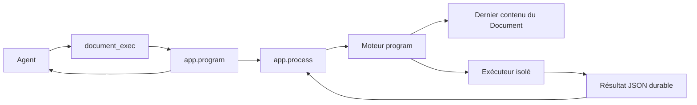

# Programmes documentaires avec entrée et sortie JSON

- Statut : `design`.
- Date : 2026-10-11.
- Objectif : permettre aux agents de créer des programmes dans les Documents, de les exécuter avec du JSON, de récupérer du JSON et de les améliorer eux-mêmes.
- Exigence utilisateur : chaque nouvelle exécution utilise le dernier contenu sauvegardé du document. Aucun choix de révision, publication de version ou pointeur de version active.

Le point d'entrée proposé est `document_exec(program="total_commandes", data=...)`.
Le nom désigne un programme du catalogue personnel de l'agent ; une URI `document://…`
peut aussi identifier directement son document. Le serveur exécute le programme sans
navigateur et conserve un résultat durable. Les APIs décrites ci-dessous sont à construire.

Revue du 20 octobre 2026 : cette proposition reste une conception. Aucun `document_exec`
n'est exposé. Le moteur BPMN possède un port de programme conditionnel dont l'exécuteur
reste absent ; cela ne livre pas l'exécution serveur des Documents. Les Datasets sont
désormais indépendants `data://`, et les données d'un run appartiennent à Process.
La conception ci-dessous doit être réconciliée avec ces frontières avant implémentation :
une fonction autonome ne devient pas un workflow métier par son suivi durable. Les
contrats actuels et l'[ADR 0197](../decisions/0197-process-owned-bpmn-storage.md) priment
sur les propositions de stockage et de suivi conservées ici.

## 1. Garanties attendues

| Garantie | Vérification de réception |
|---|---|
| Création autonome | Un agent autorisé crée un document Programme, lui donne un nom et le retrouve dans son catalogue de Processes. |
| JSON en entrée et en sortie | Objets, tableaux, chaînes, nombres, booléens et `null` traversent le parcours complet sans transformation implicite. |
| Dernier contenu sauvegardé | Après une modification, le prochain démarrage utilise le nouveau code, sans publication ni sélection de version. |
| Résultat fidèle | Les champs métier, notamment `token` ou `password` dans des données synthétiques, et les structures profondes restent intacts dans le résultat autorisé. |
| Autonomie bornée | Les droits déjà accordés permettent création, essais et amélioration ; le programme ne peut pas étendre ses capacités. |
| Exécution durable | Une réponse perdue, une panne du worker ou une double soumission n'inventent pas une réussite et ne font pas perdre un résultat déjà enregistré. |
| Isolation | Code, données et résultats d'un autre agent restent inaccessibles ; un programme ne reçoit aucune session humaine ni aucun secret serveur. |
| Arrêt effectif | Une boucle infinie, une saturation mémoire et une annulation libèrent réellement le processus d'exécution. |
| Compatibilité | Les documents HTML, leurs applications navigateur, les Datasets et les Processes existants conservent leurs contrats. |

## 2. Socle existant et écarts

Les documents disposent déjà d'URI canoniques, de partage, d'historique et de contrôles
d'écriture. `DocumentType` et la contrainte SQL limitent actuellement les formats à
`html` et `dataset`. Les scripts des documents HTML s'exécutent dans le navigateur du
lecteur ; ce runtime ne constitue pas un exécuteur autonome de programmes.

`app.process` possède définitions, runs, jobs de démarrage, leases, transitions,
déduplication, suivi et résolution des attentes Task. Son registry accepte plusieurs
moteurs. `IntegratedProcessEngine.prepare_input` permet une préparation spécifique.
Les fonctions personnelles existantes lancent les définitions affectées à l'agent ;
`process_admin_*` constitue une surface administrative distincte.

Deux adaptations sont indispensables :

- Les entrées et sorties Process sont des objets JSON. Une enveloppe interne
  `{ "data": valeur_json }` permettra toutes les racines JSON sans modifier les moteurs existants.
- `app.process.sanitizer` masque certaines clés, limite la profondeur et tronque les
  sorties. Le résultat métier exact doit être conservé dans `app.program`, puis
  référencé par une petite sortie Process. Le sanitizer reste appliqué aux diagnostics.

Sources de référence : `back/app/memory/document_types.py`, `models.py`,
`document_service.py`, `back/app/file_share/resource_service.py`,
`back/app/process/engine.py`, `schemas.py`, `models.py`, `checkpoints.py`,
`process_service.py`, `sanitizer.py` et leurs tests.

## 3. Contrat de document Programme

Ajouter le type immuable `document_type="program"` aux Documents. Il utilise le même
classement, partage et historique que les autres documents. Son contenu UTF-8 est un
paquet JSON versionné contenant le source ; aucun HTML éditorial n'est injecté dans ce
source. Le format de paquet sert à faire évoluer le contrat de stockage, pas à choisir
une version du programme lors d'un lancement.

Paquet minimal proposé :

```json
{
  "format": "galaris.program/v1",
  "language": "javascript",
  "source": "function main(data) { return { total: data.commandes.reduce((s, c) => s + c.montant, 0) }; }"
}
```

Les champs facultatifs `input_schema`, `output_schema` et `tests` appartiennent au même
contenu sauvegardé. Un test contient un nom, une entrée `data` et un résultat `expected`.
Le premier socle accepte un seul langage, JavaScript, avec une fonction synchrone
`main(data)`. Les Promises sont refusées explicitement ; les calculs n'ont aucun besoin
d'API asynchrone dans ce périmètre.

Le paquet est validé structurellement à la sauvegarde : format, langage, tailles,
champs connus et contrats JSON. Les erreurs de syntaxe du source et l'absence de
`main` sont signalées par l'exécution ou les tests. Un code erroné reste éditable et
n'entraîne jamais un retour automatique vers un ancien contenu.

Les schémas utilisent un dialecte JSON Schema explicite, avec références internes
uniquement, tailles et profondeur bornées. Leur validation doit aussi être bornée en
temps. Si une bibliothèque supplémentaire est nécessaire, vérifier les dépendances
déjà disponibles avant d'en ajouter une.

Le langage emploie des nombres JavaScript : refuser les entiers hors de la plage sûre
de ±(2^53−1) aux frontières, sans arrondi silencieux. Les grands entiers exacts et
montants décimaux exigeant une précision exacte passent par des chaînes avec un
contrat explicite. Refuser les nombres non finis, valeurs `undefined`, fonctions,
cycles et autres sorties hors du modèle JSON. La sérialisation ne doit pas convertir
ces valeurs silencieusement en `null` ou supprimer leurs propriétés.

Créer, lire et modifier le document avec les fonctions `file_*` existantes. Les
protections de concurrence à l'écriture restent celles des Documents ; elles ne
deviennent pas un paramètre de sélection pour `document_exec`.

## 4. Nom du programme et fonctions MCP

Le titre du document est libre. Le nom technique est court et stable, unique dans
le catalogue de l'agent, par exemple `total_commandes`. Deux agents peuvent avoir
le même nom pour des documents différents. Un conflit dans un catalogue personnel
retourne une erreur ; aucun suffixe ni remplacement automatique.

| Fonction proposée | Contrat |
|---|---|
| `document_register(program, document, description="")` | Enregistre pour l'agent appelant le nom et l'URI du document Programme ; crée ou réutilise sa définition Process personnelle. Aucun argument `agent_id` arbitraire. |
| `document_exec(program, data, wait=true, idempotency_key=null)` | Lance le dernier contenu du document désigné par nom personnel ou URI ; retourne le résultat disponible ou une référence de suivi. |
| `document_exec_get(run_id)` | Relit l'état et le résultat du même run, sans exécuter à nouveau le programme. |
| `document_test(program)` | Exécute les exemples du dernier contenu, dans le même moteur et avec un budget global ; retourne un bilan JSON. |

Le catalogue, la description et la désactivation d'une définition restent accessibles
par les surfaces Process appropriées. Ajouter une commande personnelle de retrait
d'enregistrement seulement si le CRUD existant ne couvre pas cette action dans le
périmètre de l'appelant. Ne pas donner les droits globaux `process_admin` pour cet usage.

Exemple d'appel :

```text
document_exec(
  program="total_commandes",
  data={"commandes": [{"montant": 10}, {"montant": 20}]}
)
```

Réponse proposée pour un petit résultat :

```json
{
  "run_id": "11111111-1111-4111-8111-111111111111",
  "status": "success",
  "program": "total_commandes",
  "document": "document://22222222-2222-4222-8222-222222222222",
  "result": {"total": 30}
}
```

`data` est obligatoire et peut valoir `null`. Ne jamais utiliser `data or {}` ni
confondre une sortie `null`, `false`, `0`, `[]` ou `{}` avec une absence de résultat.
Un terminal `success` contient un résultat ou sa référence complète. Une erreur
contient `error: {code, message}` ; une attente contient la référence de suivi.

`wait=true` attend un délai court borné, puis retourne `queued` ou `running` si le
run n'est pas terminé. L'expiration de cette attente n'annule pas le run et ne
déclenche aucune deuxième soumission. `document_exec_get` est la voie de reprise.

Pour un résultat volumineux, retourner `result_uri` et la taille, plutôt que tronquer
le JSON. Étendre la façade de ressources avec une projection en lecture seule
`galaris://program_run/<uuid>/result`, possédée par `app.program`, lisible par
`file_info` et `file_read` avec pagination bornée. L'API humaine peut télécharger
le JSON complet dans les limites du moteur. `file_copy` peut en conserver une copie
Dataset ; cette copie ne devient pas le résultat historique du run.

Les outils suivent les modes Actif/Bloqué/Sur demande et les autorisations d'action
existantes. Avec les capacités actives dans son périmètre, l'agent peut créer,
enregistrer, exécuter et améliorer ses programmes sans étape humaine de publication.
Un accord personnel Dataset de lecteur ne donne aucune autorité à cette exécution.

## 5. Sémantique de la dernière sauvegarde

Le moteur relit le dernier contenu sauvegardé **au démarrage effectif du calcul**,
après l'attente en file et les éventuelles autorisations. Une modification pendant
l'attente est donc prise en compte. Le nom enregistré continue à désigner le même
document ; le titre et la description ne déterminent pas le code chargé.

Au démarrage, le serveur vérifie de nouveau les droits, charge ensemble source,
schémas et exemples, puis transmet ce contenu au runtime. Une modification ultérieure
s'applique aux prochains démarrages. Le calcul déjà commencé garde son contenu en
mémoire et n'est pas modifié au milieu de son exécution.

Conserver en interne l'empreinte du contenu réellement chargé et l'identité du moteur
pour le diagnostic. Aucun paramètre public ne permet de choisir une ancienne révision.
L'historique documentaire reste consultable ; une restauration devient simplement le
dernier contenu sauvegardé. Les tests sont informatifs : ils ne créent ni version
active ni promotion obligatoire. Chaque lancement valide malgré tout son contrat.

Une nouvelle invocation produit un nouveau run, même avec le même nom et les mêmes
données. La déduplication générique Process par empreinte pendant 300 secondes pourrait
retourner un ancien résultat après une modification ; elle doit être écartée pour
ce moteur, comme le prévoit le contrat intégré, au profit de l'identité d'invocation.

Une clé d'idempotence explicite, dans le périmètre agent/document, retrouve une soumission
existante : elle ne représente pas une nouvelle exécution de la dernière sauvegarde.
Réutiliser la même clé avec d'autres données retourne `idempotency_conflict`. Une reprise du même
run déjà commencé conserve le contenu initialement chargé. Un nouveau run relit la
dernière sauvegarde. Ne pas proposer de cache de résultat dans le premier socle.

## 6. Architecture et persistance



| Propriétaire | Responsabilité |
|---|---|
| `app.memory` | Document Programme, stockage, partage, historique et type de document. |
| `app.file_share` | URI, création/édition génériques et lecture des ressources exactes autorisées. |
| Nouveau `app.program` | Paquet de programme, catalogue personnel, validation, tests, adaptateur moteur et résultats exacts. |
| `app.process` | Définitions, runs, jobs, états, leases, idempotence, annulation et attentes. |
| Exécuteur dédié | Exécution du JavaScript avec limites physiques et protocole JSON borné. |

`app.program` s'enregistre comme moteur `program` au bootstrap. Une définition
Process personnelle désigne le document, jamais son contenu à une date donnée.
Un lancement par `process_start` ou `conversation_process_start` utilise le même
service et le même contrat `{ "data": ... }` que `document_exec`.

La préparation d'admission valide l'enveloppe, la cible et les droits ; elle ne fige
pas le source pendant l'attente. Le worker charge le dernier paquet au moment où
il démarre réellement le calcul, puis valide les données contre ses schémas actuels.

Une exécution par URI peut créer ou réutiliser une définition personnelle pour le
document autorisé, comme les moteurs intégrés. Un enregistrement par nom réutilise
cette définition. Ce sont des programmes réutilisables du catalogue métier ; ils
partagent le cycle Process dès le premier parcours, sans journal parallèle de jobs.

Persistance indicative à confirmer au lot 0 :

- `ProgramBinding` : agent, document, définition Process et nom personnel optionnel ;
  unicité du nom actif par agent et du couple agent/document. Les colonnes `_id` sont
  de vraies FK et utilisent les types des PK référencées.
- `ProgramExecution` : FK unique vers le ProcessRun, contenu chargé ou référence
  interne durable, empreinte, profil du moteur, résultat JSON exact et mesures bornées.
  Le résultat est encapsulé pour distinguer JSON `null` d'un résultat absent.
- Les runs Process conservent leurs états. Leur sortie compacte référence le résultat
  et les mesures ; les diagnostics restent assainis. Le code et le JSON métier exacts
  n'entrent pas dans les logs, événements génériques ou aperçus assainis.

Un résultat est enregistré avant l'annonce de succès. Après un crash entre ces deux
étapes, la reprise retrouve le résultat et finalise le même run. Si l'issue distante
est incertaine, réconcilier la référence d'exécution avant tout nouveau calcul.
Le superviseur de l'exécuteur garde une identité durable liée au run ; un simple
dictionnaire en mémoire ne suffit pas. Les transitions terminales restent immuables.

Les frontières passent par les contrats publics. Ajouter un port de validation du
type Programme si nécessaire pour que `app.memory` ne dépende pas de la réalisation
`app.program`. La création d'une définition passe par `app.process`. Aucun moteur
ne modifie directement les modèles Task et aucun code exécuté ne reçoit une session DB.

## 7. Moteur et isolation

Choix initial proposé : JavaScript synchrone dans QuickJS, avec un lanceur dédié et
un processus isolé par calcul. Ce choix doit passer une expérimentation avant d'être
retenu pour l'implémentation. QuickJS expose une limite mémoire, une limite de pile et
un callback d'interruption ; son interpréteur standard inclut aussi des modules
`std` et `os` qu'il ne faut pas exposer au programme.
Voir la [documentation officielle QuickJS](https://bellard.org/quickjs/quickjs.html).

Le lanceur n'installe que les fonctions nécessaires au contrat. Il refuse les imports
natifs ou disque, le chargement de bytecode fourni par le document, l'accès réseau,
les processus, l'environnement et le système de fichiers. Il ne monte ni source de
Galaris, ni volumes applicatifs, ni socket Docker. Aucune API DOM ou navigateur n'est
nécessaire. Les dépendances supplémentaires et les appels d'outils restent différés.

Les limites moteur sont doublées par un superviseur capable de tuer le processus,
y compris s'il ne répond plus aux interruptions. Définir un compte non privilégié,
un système de fichiers en lecture seule, des capacités retirées, des limites de
processus et une isolation réseau par exécution. L'environnement d'une exécution
ne peut pas lire le journal ou les données d'une autre. Le confinement doit rester
effectif même après une compromission du moteur ; un sous-processus partageant tous
les accès de son superviseur n'est pas une frontière suffisante.

Le protocole interne transmet les données comme données structurées ; il n'interpole
ni source ni JSON dans une commande shell. Séparer résultat et diagnostics pour qu'un
programme ne forge pas son reçu en écrivant sur stdout. La validation et la
sérialisation de la sortie restent soumises au même budget que le calcul.

Pour faciliter les comparaisons, le premier profil n'expose pas d'horloge ou d'aléa
implicite. Dates et graines éventuelles proviennent de l'entrée. Ne pas promettre
une identité des calculs entre moteurs différents ; le profil moteur est enregistré.

Valeurs de départ à qualifier, avec plafonds serveur non augmentables par le programme :

| Ressource | Proposition initiale |
|---|---|
| Paquet, entrée et sortie | 2 000 000 octets UTF-8 chacun. |
| Profondeur et volume JSON | Profondeur 32 et 20 000 nœuds par valeur. |
| Calcul | 10 secondes par défaut, plafond configuré 60 secondes. |
| Mémoire JavaScript | 64 Mio ; limite physique distincte du processus à mesurer. |
| Résultat dans une réponse MCP | 16 Kio ; référence complète au-delà. |
| Diagnostics | 16 Kio par run, avec redaction. |
| Concurrence | 2 calculs par agent, 8 globalement, file d'attente bornée. |
| Tests | 100 exemples au maximum, budget global de 60 secondes. |

Mesurer démarrage, p50/p95, CPU, mémoire et débit sous charge identique. Définir aussi
les quotas de programmes, de runs et de stockage par agent, et une politique de
rétention des résultats. L'historique des documents n'autorise pas une accumulation
illimitée de copies d'entrée et de code dans les runs.

## 8. Droits et intégration agentique

La lecture du document est nécessaire à son exécution ; l'outil et le périmètre
d'exécution doivent également être autorisés. Éditer exige le droit d'écriture du
document. Enregistrer un nom crée une définition uniquement pour l'agent appelant.
Les résultats appartiennent au lanceur ; lire un document partagé ne donne pas accès
aux entrées et résultats des autres lecteurs.

Revérifier les ACL au démarrage après la file. Si l'accès est révoqué, aucun nouveau
calcul ne démarre. Une révocation ne retire pas rétroactivement des données déjà
transmises à un calcul ; prévoir l'annulation explicite. Les résultats historiques
restent soumis aux droits du run et à la politique de rétention.

`document_exec` expose un descripteur d'effet d'exécution avec cible canonique
résolue avant autorisation. Le nom n'est jamais une cible globale. La préparation
résout le document ; si la cible change avant le démarrage, refaire la validation
de portée, sans étendre un accord ciblé à un autre document. Les modes Actif/Bloqué/
Sur demande et les contrôles de scope s'appliquent dans les harnais internes et externes.

Les programmes ne disposent d'aucun outil Galaris implicite. L'agent peut lire un
Dataset avec `file_read`, transmettre son JSON à `document_exec`, puis écrire le
résultat avec `file_write` sous les contrôles existants. Le SDK Dataset des applications
HTML et les accords humains par révision restent inchangés.

Documenter le parcours dans le skill runtime Galaris et la découverte des capacités.
Les programmes enregistrés utilisent la projection personnelle Process existante.
Les fonctions de lancement restent visibles selon la politique du runtime ; elles
ne doivent pas contourner le contrôleur conversationnel ni les attentes Task.
En Chat, le suivi est lié au round par le chemin conversationnel existant ; une
Task utilise l'association et la reprise Process existantes. Vérifier ces deux
consommateurs séparément avant de généraliser aux drivers externes.

## 9. Amélioration autonome et composition

Parcours initial : créer le document, enregistrer son nom, appeler `document_test`,
exécuter avec des données réelles autorisées, lire les erreurs, modifier le source,
puis tester et exécuter de nouveau. La sauvegarde suffit pour les prochains appels.
Un programme incorrect retourne une erreur explicite, jamais le résultat d'un ancien code.

Les exemples embarqués facilitent la correction, mais leur réussite ne prouve pas la
qualité métier : l'agent peut modifier simultanément source et attentes. Pour les
processus importants, comparer aussi un corpus de référence séparé et conserver les
mesures avant/après. Aucune barrière de promotion n'est ajoutée à `document_exec`.

Première composition : l'agent orchestre A puis B en transmettant le résultat JSON
de A à B. Chaque nouveau démarrage lit le dernier document concerné. Le programme
ne reçoit pas directement la capacité de lancer d'autres programmes dans le premier lot.

Extension ultérieure : un orchestrateur permet des chaînes déclarées, avec liens
parent/enfant, budget total, limites de profondeur et de nombre d'appels, détection
des cycles, politique d'erreur et annulation des enfants. Toute étape utilise le
dernier contenu à son propre démarrage. Une modification en cours de chaîne peut
donc affecter une étape suivante ; conserver les empreintes réellement exécutées
pour expliquer le résultat, sans ajouter de sélection de versions.

Les déclenchements planifiés passent par les mécanismes Goal/Task existants, après
qualification de leur portée. Les accès externes et effets métier futurs demandent
des capacités explicites et une stratégie d'idempotence des effets. Ils ne sont pas
nécessaires au premier parcours JSON vers JSON.

## 10. Lots d'implémentation

| Lot | Livrables | Réception avant le lot suivant |
|---|---|---|
| 0 — Contrats et moteur | Décision d'architecture, expérimentation confinée QuickJS, contrat JSON, sélection des limites et inventaire des consommateurs. | Identité JSON, refus des valeurs non représentables, boucle infinie arrêtée, plafond mémoire, imports et accès interdits ; coût et latence mesurés. |
| 1 — Documents Programme | Type `program`, paquet validé, contrat de stockage, CRUD `file_*`, conservation source, historique, partage et interface minimale. | Création, lecture, édition, conflit d'écriture et refus d'accès ; ouverture/aperçu inertes ; HTML et Dataset toujours utilisables. |
| 2 — Exécution durable | `app.program`, exécuteur, tables nécessaires, moteur Process, `document_exec` et `document_exec_get`, projection exacte du résultat. | Parcours complet par URI ; dernier contenu au démarrage, résultat sans sanitizer, attente courte, reprise et arrêt effectif. |
| 3 — Catalogue personnel | `document_register`, nom personnel, définition Process et exposition dans le catalogue de l'agent. | Parcours par nom ; absence de droit administratif global ; appel par les lanceurs Process existants avec même résultat. |
| 4 — Tests et amélioration | `document_test`, exemples, bilan comparable, parcours de correction et corpus de référence indépendant. | Un agent corrige un programme défectueux puis réussit un scénario de référence ; nouvel appel utilise immédiatement sa sauvegarde. |
| 5 — Parcours assemblés | Documents et Processes, Chat/Task, profils de drivers, documentation FR/EN et mesures de charge. | Usage réel synthétique, erreurs/retry/navigation, droits/révocation, redémarrage de l'exécuteur et fonctionnement de deux agents simultanés. |
| 6 — Extensions | Composition déclarée, déclencheurs, nouveaux langages ou capacités externes selon besoin concret. | Budgets partagés, droits de chaque étape, cycles/annulation et effets idempotents qualifiés séparément. |

Les lots 0 à 5 forment le premier périmètre complet demandé. Le lot 6 est une
extension ; il ne doit pas retarder la création, l'exécution et l'amélioration
autonomes de programmes personnels.

## 11. Surfaces à modifier

| Surface | Changement envisagé |
|---|---|
| `back/app/memory/document_types.py`, `models.py`, `schemas.py`, `document_service.py`, `file_facade.py` | Nouveau format, contraintes SQL, validation, format/media type et stockage sans normalisation HTML. |
| `back/app/file_share/mcp.py`, `resource_service.py`, `resource_contracts.py`, `galaris_provider.py` | Type à la création, lecture/édition JSON du paquet, métadonnées et projection des résultats autorisés. |
| Nouveau `back/app/program/` | Contrats, façade, validation, bindings, résultats, moteur, MCP/API, privilèges, données intégrées et tests. |
| `back/app/process/` | Extension publique ciblée si nécessaire pour bindings, résultat référencé, annulation et suivi ; garder les consommateurs existants. |
| Nouveau exécuteur et fichiers Compose | Image moteur verrouillée, protocole, superviseur, confinement, santé, limites et journal durable. |
| `back/modules.py`, bootstrap | Activation et enregistrement du moteur avant les jobs ; aucune soumission au chargement. |
| `front/app/memory/` et contribution frontend du programme | Type, filtrage, éditeur de source et paramètres, tests, saisie JSON et affichage du résultat/run. |
| `front/app/process/` | Présenter les définitions documentaires et suivre leurs runs avec le catalogue existant. |
| Skill runtime Galaris, docs FR/EN, `.env.example` et settings | Parcours, signature, limites, erreurs, exploitation et variables réellement nécessaires. |

L'éditeur montre le source dans CodeEditor JavaScript et les entrées/résultats dans
CodeEditor JSON. Il assemble le paquet sauvegardé sans imposer à l'utilisateur de
modifier une longue chaîne JSON échappée. Les outils restent capables de lire et
d'écrire le paquet complet. Un lecteur de programme n'exécute jamais son code par
simple ouverture ; l'exécution est une action explicite. Les applications HTML
existantes conservent leur démarrage automatique dans le navigateur.

## 12. Validation et livraison

Réutiliser les scénarios existants Document/Dataset et Process avant d'ajouter des
tests. Remplacer la frontière de l'exécuteur dans les tests de workflow DB ; exercer
également le moteur réel dans son confinement avec des données entièrement synthétiques.

| Contrat | Scénarios prioritaires |
|---|---|
| JSON | Toutes les racines, faux/vides/null, Unicode, clés sensibles synthétiques, profondeur limite, gros résultat, entier hors plage et sortie non JSON. |
| Dernier contenu | Modification avant appel, pendant attente et pendant calcul ; source invalide sans ancien fallback ; nouvel appel identique après sauvegarde. |
| Idempotence | Réponse perdue, deux démarrages concurrents du même run, même clé avec autre entrée, nouveau run sans cache implicite. |
| Résultat durable | Crash après calcul, après persistance et avant notification ; lectures répétées ; terminal conservé face à une réponse tardive. |
| Isolation | Deux agents au même nom, document partagé, alias conflit, résultat tiers, révocation pendant attente, cible changée après autorisation. |
| Moteur | Boucle infinie, récursion, allocations, serialization coûteuse, import natif/disque, environnement/réseau interdits, arrêt forcé et capacité libérée. |
| Catalogue | Enregistrement, retrait, document supprimé, accès révoqué, lancement Process personnel et administratif préexistants. |
| UI | Création/sauvegarde/réouverture, tests, erreur corrigée, run encore actif, résultat `null`, navigation avec réponse tardive et petit viewport. |
| Composition future | Dernier contenu de chaque étape, propagation JSON exacte, cycle, budget global et annulation des enfants. |

Mesurer le premier parcours complet avant de multiplier les consommateurs. Les
tests ne doivent pas figer les couleurs, la position des boutons ou le texte du
source ; ils protègent sauvegarde, droits, données, états et actions utilisables.

Prévoir `make tests ARGS='app/program/tests app/process/tests app/memory/tests/test_dataset_documents.py'`
une fois le module présent, puis les scénarios File Share et outils effectivement
touchés. Ajouter une cible Make pour la qualification de l'exécuteur réel. Charger
les skills frontend et Playwright lors du travail sur l'interface et ses tests.

Le schéma et les données intégrées passent par DbAdmin : modèles déclaratifs,
DataSource du propriétaire, `make sync-db` en développement. Aucune migration
manuscrite ni extension du baseline architectural sans revue.

Avant publication : tests ciblés, `make typecheck`, `make architecture-check`,
parcours assemblés, `APP_ENV=dev make docs-prepare`, revue du diff et
`git diff --check`, puis `make validate` sans CI sur les sources finales. Lire le
résumé et les échecs de validation ; distinguer qualification moteur, workflows
simulés et parcours réels. La publication et tout déploiement restent des actions
distinctes de ce plan.

Mettre à jour les parcours FR/EN, le catalogue de tests fonctionnels et le skill
runtime lors de l'implémentation. Régénérer les cartes, enregistrer la décision
structurelle alors retenue et faire évoluer le statut du plan. Ne pas annoncer
ce futur contrat comme déjà disponible dans les guides utilisateur.
